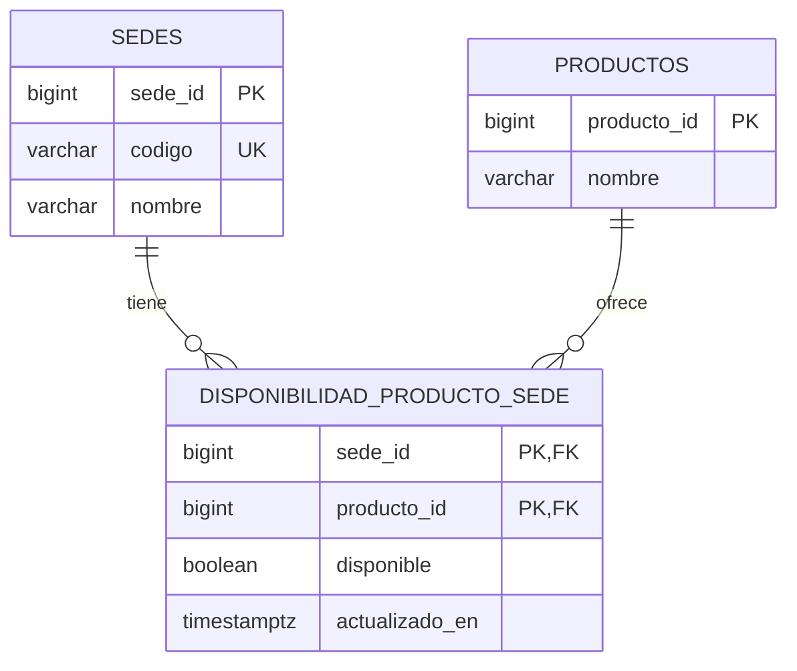

# T02.2 — Modelo de datos de productos, sedes y disponibilidad en PostgreSQL

## 1. Información general

| Campo | Descripción |
|---|---|
| Proyecto | AllInstant — ALESAR |
| Sprint | Sprint 01 |
| Historia de usuario | HU-02 — Consultar disponibilidad de productos |
| Tarea | T02.2 — Diseñar el modelo de datos de productos, sedes y disponibilidad en PostgreSQL |
| Tipo de documento | Especificación técnica del modelo de datos |
| Gestor de base de datos | PostgreSQL (Neon) |
| Versión | 1.0 |

## 2. Objetivo

Diseñar el modelo de datos que permita registrar y consultar la disponibilidad de los productos de ALESAR de forma independiente en las sedes de San Martín de Porres y La Molina. El diseño debe permitir diferenciar productos disponibles y agotados, restringir la selección de productos agotados y reflejar las modificaciones realizadas por el personal al volver a consultar el catálogo.

La estructura se integra con las tablas `productos` y `sedes` definidas anteriormente en la tarea T11.2, sin duplicarlas ni modificar los datos existentes.

## 3. Alcance

Este diseño contempla:

- Asociación entre un producto y cada sede donde se ofrece.
- Registro del estado de disponibilidad por sede.
- Consulta de productos disponibles y agotados dentro del catálogo de cada sede.
- Actualización de disponibilidad sin afectar otras sedes.
- Restricciones de integridad y consultas SQL de verificación.

No contempla conteo exacto de existencias, movimientos de inventario, precios de venta, historial de disponibilidad ni administración de cuentas del personal. Los precios utilizados al comprar se gestionarán en el componente de catálogo/pedidos correspondiente; T11.2 ya conserva el precio unitario de cada compra en `detalle_pedido`.

## 4. Historias de usuario relacionadas

**HU-02 — Consultar disponibilidad de productos.** El cliente debe conocer qué productos están disponibles en su sede, distinguir los agotados, no poder seleccionarlos y visualizar las actualizaciones al volver a consultar el catálogo.

**HU-14 — Actualizar la disponibilidad de productos.** El personal podrá marcar productos como agotados o disponibles; los cambios deberán afectar solamente a su sede.

**HU-01 — Realizar un pedido anticipado para recojo.** La selección de productos del carrito deberá consultar la disponibilidad de la sede elegida.

## 5. Modelo entidad-relación



La asociación entre `sedes` y `productos` es de **muchos a muchos**, resuelta mediante `disponibilidad_producto_sede`. Cada combinación de sede y producto aparece como máximo una vez.

## 6. Diccionario de datos

### 6.1. Tabla `sedes` (existente)

| Campo | Tipo PostgreSQL | Restricción | Descripción |
|---|---|---|---|
| `sede_id` | BIGINT | Clave primaria | Identificador interno de la sede. |
| `codigo` | VARCHAR(12) | Único, obligatorio | Identificador de la sede, por ejemplo, `SMP` o `LM`. |
| `nombre` | VARCHAR(100) | Obligatorio | Nombre de la sede. |

### 6.2. Tabla `productos` (existente)

| Campo | Tipo PostgreSQL | Restricción | Descripción |
|---|---|---|---|
| `producto_id` | BIGINT | Clave primaria | Identificador interno del producto. |
| `nombre` | VARCHAR(150) | Obligatorio | Nombre del producto. |

### 6.3. Tabla `disponibilidad_producto_sede` (nueva)

| Campo | Tipo PostgreSQL | Restricción | Descripción |
|---|---|---|---|
| `sede_id` | BIGINT | Clave primaria compuesta, clave foránea | Sede donde se ofrece el producto. |
| `producto_id` | BIGINT | Clave primaria compuesta, clave foránea | Producto asociado a la sede. |
| `disponible` | BOOLEAN | Obligatorio; por defecto `FALSE` | `TRUE`: disponible; `FALSE`: agotado. |
| `actualizado_en` | TIMESTAMPTZ | Obligatorio | Fecha y hora del último cambio de disponibilidad. |

La clave primaria compuesta (`sede_id`, `producto_id`) evita duplicar la disponibilidad del mismo producto en una misma sede. Los campos `sede_id` y `producto_id` referencian las tablas existentes.

## 7. Reglas de integridad y comportamiento

**RI-01. Independencia por sede.** La disponibilidad se registra por combinación de sede y producto; modificarla para SMP no afecta a La Molina.

**RI-02. Estados permitidos.** El campo `disponible` admite únicamente los valores booleanos `TRUE` y `FALSE`; no permite nulos.

**RI-03. Alta conservadora.** Una nueva asociación entre producto y sede se crea como agotada (`FALSE`) hasta que el personal habilite el producto. Esta es una regla técnica para evitar ofrecer productos sin verificar su disponibilidad.

**RI-04. Identidad única.** No podrán registrarse dos filas con la misma combinación (`sede_id`, `producto_id`).

**RI-05. Integridad referencial.** No se registrará disponibilidad para sedes o productos inexistentes.

**RI-06. Diferencia entre agotado y no ofrecido.** Una fila con `disponible = FALSE` representa un producto ofrecido por la sede, pero temporalmente agotado. Si no existe fila para esa combinación, el producto no forma parte del catálogo de esa sede.

**RI-07. Actualización temporal.** La columna `actualizado_en` se actualizará automáticamente cuando cambie `disponible`.

**RI-08. Validación en el servidor.** La interfaz deshabilitará el botón de un producto agotado, pero el backend deberá volver a consultar la disponibilidad antes de admitirlo en el carrito y antes de confirmar una compra. Una validación solo visual no es suficiente.

**RI-09. Autorización por sede.** El servicio de actualización deberá comprobar que el personal o dispositivo está autorizado para modificar la sede correspondiente. La existencia de una clave foránea no sustituye el control de permisos.

**RI-10. No se utiliza inventario numérico.** El estado es una declaración operativa del personal; no se calcula automáticamente a partir de un número de unidades en stock.

## 8. Consultas principales

### 8.1. Catálogo con disponibilidad de una sede

```sql
SELECT p.producto_id, p.nombre, d.disponible, d.actualizado_en
FROM disponibilidad_producto_sede AS d
JOIN productos AS p ON p.producto_id = d.producto_id
WHERE d.sede_id = $1
ORDER BY p.nombre, p.producto_id;
```

La consulta devuelve productos disponibles y agotados ofrecidos por esa sede. El sistema representará `FALSE` mediante el indicador «Agotado» y deshabilitará su selección.

### 8.2. Comprobar disponibilidad antes de seleccionar

```sql
SELECT EXISTS (
    SELECT 1
    FROM disponibilidad_producto_sede
    WHERE sede_id = $1
      AND producto_id = $2
      AND disponible = TRUE
) AS puede_seleccionarse;
```

### 8.3. Marcar un producto como agotado

```sql
UPDATE disponibilidad_producto_sede
SET disponible = FALSE
WHERE sede_id = $1 AND producto_id = $2;
```

### 8.4. Restablecer su disponibilidad

```sql
UPDATE disponibilidad_producto_sede
SET disponible = TRUE
WHERE sede_id = $1 AND producto_id = $2;
```

Los parámetros `$1` y `$2` los suministrará el backend después de validar la sede autorizada; no deben tomarse como prueba de autorización por sí mismos.

## 9. Implementación en Neon

La base de datos de desarrollo ya dispone de las tablas `sedes` y `productos`, creadas durante T11.2. Por lo tanto, se ejecutará **únicamente** el archivo `03_disponibilidad_producto_sede.sql` en la rama `development` del proyecto `allinstant-dev`.

El script incorpora la nueva tabla, su índice de consulta y un trigger para conservar el momento de la modificación. No recrea las tablas anteriores ni inserta datos de productos reales.

Después se ejecutará `04_pruebas_disponibilidad.sql` para verificar el comportamiento. Las pruebas utilizan datos ficticios y `ROLLBACK`, por lo que no deben dejar productos de prueba almacenados. Antes de ejecutar cualquier script se debe comprobar que está seleccionada la rama `development` y no `production`.

## 10. Escenarios de validación BDD

### EV-01. Disponibilidad distinta en cada sede

**Dado que** un mismo producto está disponible en SMP y agotado en La Molina,  
**cuando** se consulta su disponibilidad en cada sede,  
**entonces** el resultado debe ser disponible en SMP y agotado en La Molina.

### EV-02. Identificación de producto agotado

**Dado que** un producto tiene `disponible = FALSE` en una sede,  
**cuando** el catálogo consulta la disponibilidad del producto,  
**entonces** deberá identificarlo como agotado.

### EV-03. Restricción de selección

**Dado que** un producto está agotado en la sede seleccionada,  
**cuando** el cliente intenta agregarlo al carrito,  
**entonces** la validación de disponibilidad debe impedir su incorporación.

### EV-04. Actualización de disponibilidad

**Dado que** el personal modifica el estado de disponibilidad de un producto,  
**cuando** el cliente vuelve a consultar el catálogo de esa sede,  
**entonces** deberá observar el nuevo estado registrado.

### EV-05. Actualización aislada por sede

**Dado que** un producto está disponible en ambas sedes,  
**cuando** el personal de SMP lo marca como agotado,  
**entonces** debe permanecer disponible en La Molina.

### EV-06. Restablecimiento de un producto

**Dado que** un producto está agotado en una sede,  
**cuando** el personal cambia su estado a disponible,  
**entonces** las consultas posteriores deben permitir su selección.

### EV-07. Prevención de registros duplicados

**Dado que** existe una asociación de producto y sede,  
**cuando** se intenta registrar otra con los mismos identificadores,  
**entonces** PostgreSQL debe rechazar la duplicación.

## 11. Matriz de trazabilidad

| Criterio HU-02 | Diseño / reglas | Escenarios |
|---|---|---|
| CA-01. Productos disponibles | Relación sede-producto y columna `disponible`; RI-01, RI-02 | EV-01 |
| CA-02. Productos agotados | `disponible = FALSE`; RI-06 | EV-02 |
| CA-03. Restricción de productos no disponibles | Consulta de comprobación; RI-08 | EV-03 |
| CA-04. Actualización de disponibilidad | Operaciones `UPDATE`; RI-07, RI-09 | EV-04, EV-05, EV-06 |

Los escenarios EV-07 y las reglas de integridad complementan los criterios funcionales para garantizar la consistencia de los datos.

## 12. Integración con el resto del sistema

La tabla `disponibilidad_producto_sede` complementa el diseño T11.2 sin cambiar la relación existente entre `detalle_pedido` y `productos`. Los detalles conservan los productos y sus precios unitarios históricos; las variaciones de disponibilidad posteriores no modifican un pedido ya confirmado.

Las tareas T02.3 y T02.4 utilizarán el valor de `disponible` para representar los indicadores visuales y restringir el carrito. La HU-14 permitirá al personal modificar ese valor en la sede correspondiente. La lógica de autorización, la sincronización del catálogo y la gestión de pagos se resolverán en sus respectivos componentes de aplicación.

## 13. Conclusión

El modelo propuesto incorpora una tabla de asociación entre sedes y productos que permite registrar una disponibilidad independiente por establecimiento, sin modificar las estructuras ya creadas para pedidos. Las claves foráneas, la clave primaria compuesta y el estado booleano permiten representar los productos ofrecidos, distinguir los agotados y consultar su disponibilidad de manera consistente.

Esta especificación constituye la base técnica del módulo de disponibilidad de AllInstant y facilita su integración con el catálogo, el carrito de compras y la gestión operativa de las dos sedes de ALESAR.
