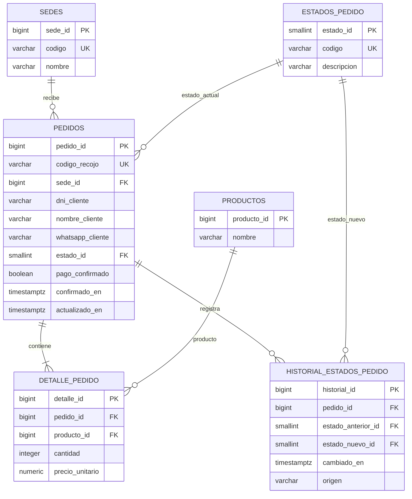

# T11.2 — Diseño de almacenamiento de pedidos y estados en PostgreSQL

## 1. Información general

| Campo | Descripción |
|---|---|
| Proyecto | AllInstant — ALESAR |
| Sprint | Sprint 01 |
| Historia de usuario | HU-11 — Visualizar los pedidos recibidos |
| Tarea | T11.2 — Diseñar la estructura de almacenamiento de pedidos y estados en PostgreSQL |
| Tipo de documento | Especificación técnica de base de datos |
| Motor de base de datos | PostgreSQL (implementado en Neon, PostgreSQL 18.6) |
| Entorno de validación | Neon: proyecto `allinstant-dev`, rama `development`, base `neondb` |
| Versión | 2.0 |

## 2. Objetivo

Definir una estructura relacional para almacenar los pedidos confirmados de AllInstant, sus productos, la sede de atención, el estado operativo actual y el historial de cambios. El diseño debe permitir recuperar listas de cocina y despacho filtradas por sede y ordenadas cronológicamente, de acuerdo con las reglas de la T11.1.

## 3. Alcance

Incluye las tablas `sedes`, `productos` (referencia mínima), `estados_pedido`, `pedidos`, `detalle_pedido` e `historial_estados_pedido`; sus relaciones, restricciones, índices, vistas de consulta y mecanismos de registro del historial. El catálogo integral y la disponibilidad por sede pertenecen a otros componentes y deberán integrarse con la tabla de productos definitiva.

No se define el proceso de cancelación ni una tabla de transacciones de pago. El esquema almacena **solo pedidos confirmados** y rechaza `pago_confirmado = FALSE`; esta restricción no demuestra que un proveedor haya cobrado. HU-10 debe comprobar el pago real antes de insertar y registrar cabecera y líneas en una misma transacción. El esquema no impide por sí solo una cabecera sin detalles.

El DNI se almacena como ocho caracteres numéricos, por acuerdo funcional; este control de formato no sustituye una eventual validación de pertenencia institucional.

## 4. Modelo entidad-relación



**Nota:** El mínimo de una línea por pedido, expresado en el DER, debe garantizarlo el servicio transaccional de creación, ya que el esquema SQL no impide insertar una cabecera sin detalles. Las seis tablas del diagrama ya existen en T11.2; T11.3 no añade tablas ni columnas.

## 5. Diccionario de datos

### 5.1. Tabla `sedes`

| Campo | Tipo | Restricción | Descripción |
|---|---|---|---|
| `sede_id` | BIGINT | PK, identidad | Identificador interno |
| `codigo` | VARCHAR(12) | UNIQUE, NOT NULL | SMP o LM |
| `nombre` | VARCHAR(100) | NOT NULL | Nombre de la sede |

### 5.2. Tabla `productos`

| Campo | Tipo | Restricción | Descripción |
|---|---|---|---|
| `producto_id` | BIGINT | PK, identidad | Identificador interno |
| `nombre` | VARCHAR(150) | NOT NULL | Nombre referencial |

### 5.3. Tabla `estados_pedido`

| Campo | Tipo | Restricción | Descripción |
|---|---|---|---|
| `estado_id` | SMALLINT | PK | Identificador del estado |
| `codigo` | VARCHAR(30) | UNIQUE, NOT NULL | Código estable |
| `descripcion` | VARCHAR(80) | NOT NULL | Texto de presentación |

Estados definidos: `1 RECIBIDO`, `2 PREPARANDO`, `3 LISTO_RECOJO`, `4 ENTREGADO`.

### 5.4. Tabla `pedidos`

| Campo | Tipo | Restricción | Descripción |
|---|---|---|---|
| `pedido_id` | BIGINT | PK, identidad | Identificador interno autogenerado |
| `codigo_recojo` | VARCHAR(20) | UNIQUE, NOT NULL | Código público diferente del ID interno |
| `sede_id` | BIGINT | FK, NOT NULL | Sede de atención |
| `dni_cliente` | VARCHAR(8) | NOT NULL, 8 dígitos | DNI ingresado |
| `nombre_cliente` | VARCHAR(150) | NOT NULL | Nombre usado para el recojo |
| `whatsapp_cliente` | VARCHAR(20) | NOT NULL | Contacto asociado |
| `estado_id` | SMALLINT | FK, NOT NULL; DEFAULT 1 en T11.2, DEFAULT 2 tras T11.3 | Estado actual |
| `pago_confirmado` | BOOLEAN | NOT NULL, TRUE | Constancia lógica de confirmación previa |
| `confirmado_en` | TIMESTAMPTZ | NOT NULL | Momento de confirmación |
| `actualizado_en` | TIMESTAMPTZ | NOT NULL | Momento del último cambio de estado |

No se almacena un monto total derivado: puede calcularse como suma de `cantidad * precio_unitario`. El código público debe generarse de forma no predecible por la aplicación y tratarse como dato sensible de recojo; su unicidad la garantiza PostgreSQL.

### 5.5. Tabla `detalle_pedido`

| Campo | Tipo | Restricción | Descripción |
|---|---|---|---|
| `detalle_id` | BIGINT | PK, identidad | Identificador de línea |
| `pedido_id` | BIGINT | FK, NOT NULL | Pedido asociado |
| `producto_id` | BIGINT | FK, NOT NULL | Producto comprado |
| `cantidad` | INTEGER | > 0 | Unidades |
| `precio_unitario` | NUMERIC(12,2) | >= 0 | Precio al confirmar la compra |

Se evita repetir el mismo producto en varias líneas de un pedido mediante `UNIQUE(pedido_id, producto_id)`. El precio se guarda como fotografía del momento de compra.

### 5.6. Tabla `historial_estados_pedido`

| Campo | Tipo | Restricción | Descripción |
|---|---|---|---|
| `historial_id` | BIGINT | PK, identidad | Identificador del evento |
| `pedido_id` | BIGINT | FK, NOT NULL | Pedido |
| `estado_anterior_id` | SMALLINT | FK, NULL | Estado previo (nulo en la creación) |
| `estado_nuevo_id` | SMALLINT | FK, NOT NULL | Estado registrado |
| `cambiado_en` | TIMESTAMPTZ | NOT NULL | Fecha/hora del cambio |
| `origen` | VARCHAR(30) | CHECK | SISTEMA, COCINA o DESPACHO |

La inserción inicial y las transiciones válidas se registran con triggers. El trigger original de historial inserta el valor real de `NEW.estado_id`; tras la migración T11.3 registra `PREPARANDO` sin reescribir el historial previo. Los permisos de producción deberán impedir modificar o borrar directamente el historial.

## 6. Reglas de integridad y transiciones

- Todo pedido pertenece a exactamente una sede; la sede no cambia después de confirmarse.
- El SQL original T11.2 exigía que cada pedido naciera `RECIBIDO` (estado 1). La migración T11.3, aplicada en Neon `development` según la verificación reportada, cambia el valor predeterminado y la validación de inserción a `PREPARANDO` (estado 2) para pedidos nuevos. No modifica pedidos existentes.
- `RECIBIDO` se mantiene en el catálogo, en ambas vistas y como estado de pedidos históricos. La transición heredada `RECIBIDO → PREPARANDO` con origen `COCINA` continúa permitida para esos pedidos; la interfaz vigente de cocina T11.4 opera únicamente pedidos que ya están en `PREPARANDO`.
- La transición `PREPARANDO → LISTO_RECOJO` la registra despacho, después de que cocina comunique la finalización.
- La transición `LISTO_RECOJO → ENTREGADO` la registra despacho.
- No se permite retroceder ni cambiar directamente a estados posteriores. `ENTREGADO` es terminal en esta versión.
- Los pedidos entregados se conservan en la base de datos y se excluyen solo de las vistas activas.
- Un pago rechazado no crea una fila en `pedidos`.
- Los datos de contacto no deben exponerse en la vista de cocina.
- Cocina usa `/control-cocina/smp` y `/control-cocina/lm` para comunicar el fin de preparación sin cambiar el estado. Las rutas históricas `/cocina/*` fueron retiradas. El filtrado por sede no equivale a autorización pública; el despliegue debe restringir acceso por red interna o VPN, firewall/proxy y HTTPS.

## 7. Vistas, consulta operativa y eventos

La vista SQL original `vista_pedidos_cocina` devuelve una fila **por pedido** en `RECIBIDO` o `PREPARANDO`, con código, sede, hora, estado y total de unidades. La vista SQL original `vista_pedidos_despacho` devuelve una fila por pedido en `RECIBIDO`, `PREPARANDO` o `LISTO_RECOJO`, con nombre de cliente y código de recojo. Ninguna vista ordena o restringe sede por sí misma; cualquier consumidor debe añadir filtro `sede_id` y orden explícito. T11.4 implementa la interfaz de despacho con consultas parametrizadas a las tablas base.

El siguiente SQL corresponde al monitor histórico T11.3, conservado como referencia; ya no lo consume la aplicación:

```sql
SELECT d.detalle_id, d.pedido_id, d.producto_id, pr.nombre, d.cantidad
FROM pedidos p
JOIN detalle_pedido d ON d.pedido_id = p.pedido_id
JOIN productos pr ON pr.producto_id = d.producto_id
WHERE p.sede_id = $1 AND p.estado_id IN (1, 2) AND p.pago_confirmado = TRUE
ORDER BY p.confirmado_en ASC, p.pedido_id ASC, d.detalle_id ASC;
```

La interfaz vigente T11.4 consulta pedidos `PREPARANDO` pagados sin aviso de preparación, con sus productos y cantidades, ordenados por `confirmado_en` y `pedido_id`. No envía DNI, teléfono ni código de recojo al navegador de cocina.

Tras aplicar T11.3, los triggers emiten `NOTIFY allinstant_cocina` con **solo el ID numérico de sede** al insertar pedidos activos, cambiar estados que afecten a cocina, insertar/editar/eliminar detalles visibles y renombrar productos usados en pedidos activos. El `NOTIFY` es una señal de invalidación, no el contenido de la lista. PostgreSQL lo entrega tras `COMMIT`; varias señales idénticas dentro de la misma transacción pueden consolidarse.

El endpoint GET `/api/operations/[site]/stream?mode=control` usa una conexión directa a Neon para `LISTEN allinstant_cocina` y `allinstant_despacho`; despacho usa el mismo endpoint con `mode=dispatch`. Se configura con `DATABASE_LISTEN_URL` o, si se omite, con el endpoint directo derivado de `DATABASE_URL` cuando esta usa el pooler de Neon. Hace una consulta completa después de establecer la escucha y cada vez que recibe un aviso de su sede. El navegador usa SSE/EventSource, reconecta automáticamente y recibe otra foto completa; esto recupera cambios ocurridos durante la desconexión. Un proceso Node persistente y una ruta de red sin buffering SSE son necesarios.

## 8. Scripts SQL y pruebas

- `Sprint 2/Codigo/Base de Datos/T11.2_estructura_pedidos_y_estados.sql`: crea las seis tablas, restricciones, índices, triggers, catálogo y vistas de la implementación original. Está ubicado en Sprint 2 pese a corresponder a T11.2 de Sprint 1; se recomienda reubicarlo en Sprint 1 en una integración coordinada, conservando contenido y trazabilidad. Aquí no se mueve ni reejecuta.
- `Sprint 1/Testing/T11.2_pruebas_pedidos_y_estados.sql`: prueba la implementación original y revierte datos ficticios. Espera inserciones `RECIBIDO`, por lo que es código histórico, **no** una prueba posterior a T11.3. La captura de aquella ejecución permanece en `Sprint 1/Pruebas/capturas/`.
- `Sprint 1/Codigo/T11.3_migracion_pedidos_cocina.sql`: cambio del estado inicial y avisos PostgreSQL; aplicado en Neon `development` según los resultados reportados.
- `Sprint 1/Testing/T11.3_pruebas_post_migracion.sql`: comprobaciones con `BEGIN` y `ROLLBACK` ejecutadas tras aplicar T11.3, según los resultados reportados.
- `Sprint 1/Testing/T11.3_verificacion_post_migracion.sql`: consultas de solo lectura de default, triggers, funciones, vistas y distribución del historial.
- `Sprint 1/Codigo/T11.3_reversion_pedidos_cocina.sql`: restaura las funciones y el default originales sin borrar datos; requiere revisar dependencias y coordinar el backend productor antes de usarlo.

Los scripts **originales T11.2** se ejecutaron mediante el editor SQL de Neon sobre la rama `development`, según la evidencia del proyecto. No deben volver a aplicarse sobre una base que ya contiene estas tablas. La migración y las pruebas T11.3 también se reportaron como ejecutadas en `development`; esta actualización documental no ejecutó SQL. Las instrucciones y precauciones de base de datos están en `Sprint 1/Codigo/README_T11.3_BD.md`.

### Matriz de pruebas originales T11.2

| ID | Caso | Resultado esperado |
|---|---|---|
| P01 | Insertar pedido confirmado en SMP | Aparece solo al consultar SMP |
| P02 | Agregar dos unidades de un producto | Cocina obtiene `total_unidades = 2` |
| P03 | Registrar creación de pedido | Existe historial inicial `RECIBIDO` |
| P04 | Cocina inicia preparación | Estado cambia a `PREPARANDO` |
| P05 | Despacho registra pedido listo | Pedido sale de cocina, sigue en despacho |
| P06 | Despacho registra entrega | Pedido sale de ambas listas activas |
| P07 | Consultar historial | Permanece la secuencia de cuatro estados |
| P08 | Intentar retroceder estado | PostgreSQL rechaza la transición |
| P09 | Insertar pedido con pago no confirmado | PostgreSQL rechaza la inserción |

La matriz anterior describe el comportamiento **previo** a T11.3. Las pruebas T11.3 verifican el nuevo `DEFAULT 2`, historial inicial `PREPARANDO`, filtro por sede, detalle, nombre de producto, transiciones `2 → 3 → 4`, retiros de vistas y rechazo de pago no confirmado. Su ejecución satisfactoria fue reportada por el proyecto. Como usan `ROLLBACK`, no pueden demostrar entrega de `NOTIFY` tras `COMMIT`; esa comprobación se documenta por separado como integración SSE.

### Resultado histórico de validación T11.2 en Neon

El equipo ejecutó ambos scripts en **Neon, PostgreSQL 18.6**, proyecto `allinstant-dev`, rama `development`, base `neondb`. La comprobación mediante el editor SQL mostró:

- Existencia de las seis tablas de la especificación.
- Consulta de restricciones de claves primarias y foráneas con 13 filas de resultado; la captura disponible mostraba parcialmente las relaciones.
- Registro de los cuatro estados: `RECIBIDO`, `PREPARANDO`, `LISTO_RECOJO`, `ENTREGADO`.
- Existencia de las dos vistas: `vista_pedidos_cocina` y `vista_pedidos_despacho`.
- Ejecución del script de pruebas con 15 sentencias y resultado `PRUEBAS COMPLETADAS (transacción revertida)`.

La instrucción final `ROLLBACK` deshizo los datos ficticios de las pruebas originales. Estos resultados históricos solo verifican T11.2; la validación posterior de T11.3 se documenta por separado en [la implementación del monitor](T11.3-implementacion-monitor-cocina.md). La reversión T11.3 permanece disponible, sin ejecutar.

## 9. Trazabilidad con la HU-11 y T11.1

| Necesidad funcional | Implementación y estado |
|---|---|
| Sede correcta | FK `pedidos.sede_id`; filtro parametrizado en consulta T11.3 y selección de sede en servidor |
| Pedido e historial | `pedido_id`, `codigo_recojo` únicos; `historial_estados_pedido` y triggers T11.2 |
| Estado inicial `PREPARANDO` | Default y función de control en migración T11.3 aplicada en `development`, según verificación reportada |
| Pedidos `RECIBIDO` previos | Catálogo y vistas T11.2 se conservan; transición 1 → 2 continúa válida |
| Cocina: ID, nombre y cantidad por línea | Consulta de `pedidos`, `detalle_pedido`, `productos` en T11.3; no usa la vista agregada |
| Despacho: pedidos pendientes | `vista_pedidos_despacho` existente; interfaz T11.4 implementada |
| Orden de más antiguo a más reciente | `confirmado_en`, `pedido_id`, `detalle_id` ascendentes en T11.3 |
| Actualización automática | SSE implementado en Next.js; triggers `NOTIFY` reportados como activos en `development` |
| Conservar entregados | Cambio de estado sin eliminar pedido o historial |

## 10. Consideraciones de integración

El módulo de catálogo deberá acordar el uso de `productos.producto_id` como clave referenciada. HU-10 debe registrar el pedido y todos sus detalles en una transacción después de verificar el pago real: el `NOTIFY` de alta solo se entrega tras `COMMIT`, cuando ya deben existir las líneas. Este esquema no incluye una tabla de pagos, su referencia externa ni un mecanismo de verificación con el proveedor.

La base permite una cabecera sin detalles y no bloquea por sí misma escritura directa al historial o a los estados por usuarios con permisos amplios. `allinstant.origen_cambio` es una variable de sesión para validar la ruta de transición, **no** un mecanismo de autenticación; el backend y los privilegios PostgreSQL deben limitar quién puede escribir. La pantalla de cocina solo consulta. El acceso directo a rutas locales no debe convertirse en acceso público: restringir red, proxy/firewall y usar HTTPS antes del despliegue.

`LISTEN/NOTIFY` no almacena una cola durable. Las interfaces operativas resuelven pérdida de eventos por reconexión con una foto completa, pero necesitan la migración aplicada, conexión directa sin pooler y servidor Node persistente. No hay monitorización adicional de caídas prolongadas ni reconciliación periódica fuera de la reconexión.

## 11. Conclusión

Las seis tablas y dos vistas T11.2 existen como base histórica verificada en Neon `development`. T11.3 aplicó una migración acotada para el inicio `PREPARANDO` y los avisos de actualización. T11.4 reutiliza esos objetos para la interfaz única de cocina y despacho; el monitor anterior queda documentado como histórico. Su aplicación y validación posterior en `development` constan como resultados reportados por el proyecto.

Los pedidos existentes y su historial se preservan. La verificación en base de datos y la integración con HU-10 quedan diferenciadas de las funcionalidades ya implementadas.

## 12. Ampliación T11.4 aplicada en `development` (sin alterar el esquema histórico)

El SQL original T11.2 y la migración T11.3 se conservan como registro histórico. La [migración independiente T11.4](../Codigo/T11.4_migracion_avisos_preparacion.sql), aplicada y verificada en Neon `development` el 18-10-2026, añade una séptima tabla `avisos_preparacion`: `aviso_id` (identidad PK), `pedido_id` (FK `pedidos` y UNIQUE), `terminado_en` (fecha de cocina) y `confirmado_en` (fecha de despacho, nula mientras el aviso está pendiente). La unicidad impide dos avisos para una misma preparación; la sede se obtiene mediante el pedido, sin duplicarla en el aviso. Un índice parcial favorece la búsqueda de pendientes.

La función de control de estados actualizada en T11.3 sigue validando `PREPARANDO → LISTO_RECOJO → ENTREGADO`; los triggers históricos de T11.2 siguen registrando cada cambio con origen `DESPACHO`. T11.4 no reescribe esas funciones ni triggers: añade un trigger independiente que rechaza `PREPARANDO → LISTO_RECOJO` si falta un aviso confirmado, y otro que impide avisos fuera de `PREPARANDO`. Tres funciones `SECURITY DEFINER` realizan las acciones con `FOR UPDATE` y conservan la transición y la confirmación dentro de una misma sentencia atómica. Los nuevos triggers de `NOTIFY allinstant_despacho` emiten únicamente `sede_id`.

La [fase separada de privilegios](../Codigo/T11.4_privilegios_operativos.sql) aplica grupos `NOLOGIN` de lectura, cocina y despacho; los usuarios `LOGIN` limitados y sus secretos se aprovisionan fuera del repositorio. Ningún grupo recibe DML directo sobre pedidos, avisos o historial. La [reversión conservadora](../Codigo/T11.4_reversion_avisos_preparacion.sql) retira funciones y triggers T11.4, preserva avisos y devuelve la regla anterior T11.3 de `2 → 3` con origen `DESPACHO` sin requisito de aviso; requiere detener antes las rutas T11.4 y no se ha ejecutado. Consulte [la documentación de implementación T11.4](T11.4-implementacion-vista-despacho.md) para el resultado de las verificaciones y los límites operativos.

## 13. Ampliación T11.4 para pedidos sintéticos de desarrollo

En `development` se añadieron `t114_entorno_pruebas`, con la única fila permitida `development`, y `t114_pedidos_prueba`, cuyo `pedido_id` es FK de `pedidos`. La segunda tabla identifica los datos sintéticos sin usar atributos personales o semánticos de la cabecera. La función `SECURITY DEFINER` `fn_t114_generar_pedido_prueba(bigint)` crea cabecera, detalle y marcador en una llamada; los triggers preexistentes conservan la creación del historial y las señales posteriores a `COMMIT`.

La función toma una sede válida y un producto existente, respeta el estado inicial `PREPARANDO` y el pago confirmado, y usa el último precio registrado para el producto en esa base. La [migración](../Codigo/T11.4_migracion_pedidos_prueba.sql), su [ajuste aplicado](../Codigo/T11.4_ajuste_generador_pedidos_prueba.sql) y los [privilegios mínimos](../Codigo/T11.4_privilegios_pedidos_prueba.sql) no cambian el diseño histórico T11.2 ni conceden DML directo al rol del generador. La previsualización de limpieza es de solo lectura; no se ha ejecutado eliminación de pedidos sintéticos.
