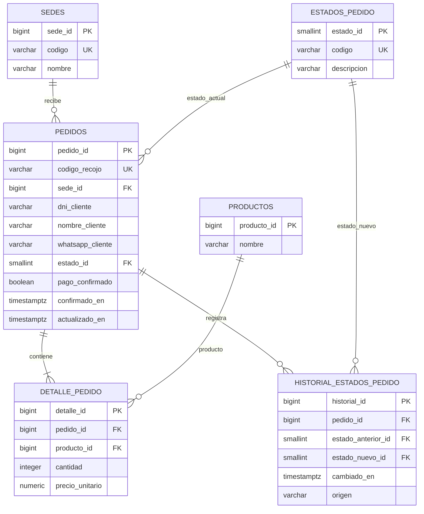

# T11.2 — Diseño de almacenamiento de pedidos y estados en PostgreSQL

## 1. Información general

| Campo | Descripción |
|---|---|
| Proyecto | AllInstant — ALESAR |
| Sprint | Sprint 01 |
| Historia de usuario | HU-11 — Visualizar los pedidos recibidos |
| Tarea | T11.2 — Diseñar la estructura de almacenamiento de pedidos y estados en PostgreSQL |
| Tipo de documento | Especificación técnica de base de datos |
| Motor de base de datos | PostgreSQL (implementado en Neon, PostgreSQL 18.6) |
| Entorno de validación | Neon: proyecto `allinstant-dev`, rama `development`, base `neondb` |
| Versión | 1.0 |

## 2. Objetivo

Definir una estructura relacional para almacenar los pedidos confirmados de AllInstant, sus productos, la sede de atención, el estado operativo actual y el historial de cambios. El diseño debe permitir recuperar listas de cocina y despacho filtradas por sede y ordenadas cronológicamente, de acuerdo con las reglas de la T11.1.

## 3. Alcance

Incluye las tablas `sedes`, `productos` (referencia mínima), `estados_pedido`, `pedidos`, `detalle_pedido` e `historial_estados_pedido`; sus relaciones, restricciones, índices, vistas de consulta y mecanismos de registro del historial. El catálogo integral y la disponibilidad por sede pertenecen a otros componentes y deberán integrarse con la tabla de productos definitiva.

No se define el proceso de cancelación ni se establece un modelo de transacciones de pago, porque ambas decisiones siguen abiertas. Esta versión almacena **solo pedidos confirmados**, y no permite insertar pedidos con `pago_confirmado = FALSE`. La comprobación real del pago deberá realizarse en el servicio de pagos antes de insertar el pedido. En producción, la creación de un pedido y sus líneas deberá ser transaccional.

El DNI se almacena como ocho caracteres numéricos, por acuerdo funcional; este control de formato no sustituye una eventual validación de pertenencia institucional.

## 4. Modelo entidad-relación



**Nota:** El mínimo de una línea por pedido, expresado en el DER, debe garantizarlo el servicio transaccional de creación, ya que el esquema SQL no impide insertar temporalmente una cabecera sin detalles.

## 5. Diccionario de datos

### 5.1. Tabla `sedes`

| Campo | Tipo | Restricción | Descripción |
|---|---|---|---|
| `sede_id` | BIGINT | PK, identidad | Identificador interno |
| `codigo` | VARCHAR(12) | UNIQUE, NOT NULL | SMP o LM |
| `nombre` | VARCHAR(100) | NOT NULL | Nombre de la sede |

### 5.2. Tabla `productos`

| Campo | Tipo | Restricción | Descripción |
|---|---|---|---|
| `producto_id` | BIGINT | PK, identidad | Identificador interno |
| `nombre` | VARCHAR(150) | NOT NULL | Nombre referencial |

### 5.3. Tabla `estados_pedido`

| Campo | Tipo | Restricción | Descripción |
|---|---|---|---|
| `estado_id` | SMALLINT | PK | Identificador del estado |
| `codigo` | VARCHAR(30) | UNIQUE, NOT NULL | Código estable |
| `descripcion` | VARCHAR(80) | NOT NULL | Texto de presentación |

Estados definidos: `1 RECIBIDO`, `2 PREPARANDO`, `3 LISTO_RECOJO`, `4 ENTREGADO`.

### 5.4. Tabla `pedidos`

| Campo | Tipo | Restricción | Descripción |
|---|---|---|---|
| `pedido_id` | BIGINT | PK, identidad | Identificador interno autogenerado |
| `codigo_recojo` | VARCHAR(20) | UNIQUE, NOT NULL | Código público diferente del ID interno |
| `sede_id` | BIGINT | FK, NOT NULL | Sede de atención |
| `dni_cliente` | VARCHAR(8) | NOT NULL, 8 dígitos | DNI ingresado |
| `nombre_cliente` | VARCHAR(150) | NOT NULL | Nombre usado para el recojo |
| `whatsapp_cliente` | VARCHAR(20) | NOT NULL | Contacto asociado |
| `estado_id` | SMALLINT | FK, NOT NULL | Estado actual |
| `pago_confirmado` | BOOLEAN | NOT NULL, TRUE | Constancia lógica de confirmación previa |
| `confirmado_en` | TIMESTAMPTZ | NOT NULL | Momento de confirmación |
| `actualizado_en` | TIMESTAMPTZ | NOT NULL | Momento del último cambio de estado |

No se almacena un monto total derivado: puede calcularse como suma de `cantidad * precio_unitario`. El código público debe generarse de forma no predecible por la aplicación y tratarse como dato sensible de recojo; su unicidad la garantiza PostgreSQL.

### 5.5. Tabla `detalle_pedido`

| Campo | Tipo | Restricción | Descripción |
|---|---|---|---|
| `detalle_id` | BIGINT | PK, identidad | Identificador de línea |
| `pedido_id` | BIGINT | FK, NOT NULL | Pedido asociado |
| `producto_id` | BIGINT | FK, NOT NULL | Producto comprado |
| `cantidad` | INTEGER | > 0 | Unidades |
| `precio_unitario` | NUMERIC(12,2) | >= 0 | Precio al confirmar la compra |

Se evita repetir el mismo producto en varias líneas de un pedido mediante `UNIQUE(pedido_id, producto_id)`. El precio se guarda como fotografía del momento de compra.

### 5.6. Tabla `historial_estados_pedido`

| Campo | Tipo | Restricción | Descripción |
|---|---|---|---|
| `historial_id` | BIGINT | PK, identidad | Identificador del evento |
| `pedido_id` | BIGINT | FK, NOT NULL | Pedido |
| `estado_anterior_id` | SMALLINT | FK, NULL | Estado previo (nulo en la creación) |
| `estado_nuevo_id` | SMALLINT | FK, NOT NULL | Estado registrado |
| `cambiado_en` | TIMESTAMPTZ | NOT NULL | Fecha/hora del cambio |
| `origen` | VARCHAR(30) | CHECK | SISTEMA, COCINA o DESPACHO |

La inserción inicial y las transiciones válidas se registran con triggers. Los permisos de producción deberán impedir modificar o borrar directamente el historial.

## 6. Reglas de integridad y transiciones

- Todo pedido pertenece a exactamente una sede; la sede no cambia después de confirmarse.
- Cada pedido confirmado inicia en `RECIBIDO`.
- La transición `RECIBIDO → PREPARANDO` ocurre cuando cocina abre el pedido para iniciar su preparación; la aplicación realiza el UPDATE con origen `COCINA`.
- La transición `PREPARANDO → LISTO_RECOJO` la registra despacho, después de que cocina comunique la finalización.
- La transición `LISTO_RECOJO → ENTREGADO` la registra despacho.
- No se permite retroceder ni cambiar directamente a estados posteriores. `ENTREGADO` es terminal en esta versión.
- Los pedidos entregados se conservan en la base de datos y se excluyen solo de las vistas activas.
- Un pago rechazado no crea una fila en `pedidos`.
- Los datos de contacto no deben exponerse en la vista de cocina.
- Los roles y sedes de cada pantalla deben fijarse desde el servicio autorizado: filtrar por sede en una consulta no equivale por sí solo a controlar permisos.

## 7. Vistas y consultas

La vista `vista_pedidos_cocina` devuelve pedidos `RECIBIDO` y `PREPARANDO`, código, sede, hora, estado y cantidad total de unidades. La vista `vista_pedidos_despacho` devuelve `RECIBIDO`, `PREPARANDO` y `LISTO_RECOJO`, incluyendo nombre del cliente y código de recojo.

Las vistas **no ordenan ni restringen sede por sí mismas**. La capa de aplicación debe añadir condiciones parametrizadas por `sede_id` y `ORDER BY confirmado_en ASC, pedido_id ASC`.

Ejemplo para cocina:

```sql
SELECT *
FROM vista_pedidos_cocina
WHERE sede_id = $1
ORDER BY confirmado_en ASC, pedido_id ASC;
```

Ejemplo para despacho:

```sql
SELECT *
FROM vista_pedidos_despacho
WHERE sede_id = $1
ORDER BY confirmado_en ASC, pedido_id ASC;
```

La actualización automática visible al usuario corresponde a la capa de aplicación (WebSockets, SSE u otra estrategia); PostgreSQL actúa como fuente persistente de datos, sin definir aquí el mecanismo de comunicación.

## 8. Scripts SQL y pruebas

- `T11.2_estructura_pedidos_y_estados.sql`: crea las tablas, restricciones, índices, triggers, registros de referencia y vistas.
- `T11.2_pruebas_pedidos_y_estados.sql`: inserta pedidos ficticios, verifica filtrado por sede, detalle y transición de estados; comprueba la retirada de pedidos listos de cocina, la exclusión de entregados y el historial. Utiliza `ROLLBACK` para no conservar datos de prueba.

Los scripts se ejecutaron mediante el editor SQL de Neon sobre la rama `development`. De forma alternativa, pueden ejecutarse desde un cliente `psql` conectado a esa base de datos:

```bash
psql -X -v ON_ERROR_STOP=1 -d neondb -f T11.2_estructura_pedidos_y_estados.sql
psql -X -v ON_ERROR_STOP=1 -d neondb -f T11.2_pruebas_pedidos_y_estados.sql
```

El parámetro `-d neondb` supone una conexión previamente configurada a Neon; no es suficiente por sí solo para conectar desde una computadora nueva. Los scripts no deben volver a ejecutarse en una base que ya contiene estas tablas sin verificar su idempotencia o preparar una migración.

### Matriz de pruebas

| ID | Caso | Resultado esperado |
|---|---|---|
| P01 | Insertar pedido confirmado en SMP | Aparece solo al consultar SMP |
| P02 | Agregar dos unidades de un producto | Cocina obtiene `total_unidades = 2` |
| P03 | Registrar creación de pedido | Existe historial inicial `RECIBIDO` |
| P04 | Cocina inicia preparación | Estado cambia a `PREPARANDO` |
| P05 | Despacho registra pedido listo | Pedido sale de cocina, sigue en despacho |
| P06 | Despacho registra entrega | Pedido sale de ambas listas activas |
| P07 | Consultar historial | Permanece la secuencia de cuatro estados |
| P08 | Intentar retroceder estado | PostgreSQL rechaza la transición |
| P09 | Insertar pedido con pago no confirmado | PostgreSQL rechaza la inserción |

### Resultado de la validación en Neon

El equipo ejecutó ambos scripts en **Neon, PostgreSQL 18.6**, proyecto `allinstant-dev`, rama `development`, base `neondb`. La comprobación mediante el editor SQL mostró:

- Existencia de las seis tablas de la especificación.
- Consulta de restricciones de claves primarias y foráneas con 13 filas de resultado; la captura disponible mostraba parcialmente las relaciones.
- Registro de los cuatro estados: `RECIBIDO`, `PREPARANDO`, `LISTO_RECOJO`, `ENTREGADO`.
- Existencia de las dos vistas: `vista_pedidos_cocina` y `vista_pedidos_despacho`.
- Ejecución del script de pruebas con 15 sentencias y resultado `PRUEBAS COMPLETADAS (transacción revertida)`.

La instrucción final `ROLLBACK` deshizo los datos ficticios de las pruebas. Estos resultados verifican los escenarios incluidos en los scripts; no constituyen una prueba de todos los módulos futuros de AllInstant ni de concurrencia, seguridad de acceso o pagos reales.

## 9. Trazabilidad con la HU-11 y T11.1

| Necesidad funcional | Implementación propuesta |
|---|---|
| Mostrar pedidos solo de una sede | FK `pedidos.sede_id` y filtro por sede en consulta |
| Diferenciar pedidos | `pedido_id` y `codigo_recojo` únicos |
| Visualizar estado actual | `pedidos.estado_id` relacionado con `estados_pedido` |
| Nuevos pedidos confirmados | Alta transaccional en `pedidos`, consumo posterior desde la aplicación |
| Cocina: recibido / preparando | `vista_pedidos_cocina` |
| Despacho: pendientes de entrega | `vista_pedidos_despacho` |
| Orden de más antiguo a más reciente | `confirmado_en ASC, pedido_id ASC` |
| Historial de cambios | `historial_estados_pedido` y triggers |
| Conservar entregados | El estado se actualiza sin eliminar el registro |

## 10. Consideraciones de integración

El módulo de catálogo deberá acordar el uso de `productos.producto_id` como clave referenciada. El registro del pedido y sus detalles deberá ejecutarse en una transacción para impedir cabeceras incompletas. Los valores del pago y su referencia externa se agregarán en el componente de pagos cuando se definan sus requisitos.

La actualización automática y la asignación de sede y rol a cada pantalla son responsabilidades de la capa de aplicación. El acceso directo desde dispositivos del local no debe interpretarse como autorización para consultar libremente todas las sedes.

## 11. Conclusión

El diseño propuesto organiza el almacenamiento de pedidos confirmados, sus líneas de productos y el seguimiento de estados en tablas relacionadas mediante claves y restricciones. El modelo permite construir las listas activas de cocina y despacho por sede, ordenar pedidos según su confirmación y conservar la trazabilidad histórica de cada transición.

La especificación, los scripts y los resultados verificados en Neon constituyen la base técnica del módulo de pedidos de AllInstant. El modelo podrá ampliarse mediante migraciones para integrar disponibilidad por sede, pagos y otros componentes contemplados en las historias de usuario posteriores.
