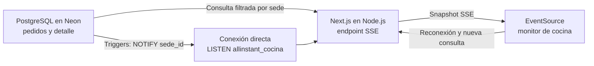

# T11.3 — Implementación del monitor de cocina

> **Documento histórico.** T11.4 sustituyó el monitor de solo lectura por `/control-cocina/smp` y `/control-cocina/lm`, que son las únicas interfaces de cocina vigentes. Las rutas `/cocina/*`, su endpoint SSE y sus componentes fueron retirados del código. Esta documentación y sus evidencias se conservan para trazabilidad de la versión implementada originalmente.

## 1. Información general

| Campo | Descripción |
|---|---|
| Proyecto | AlInstant — ALESAR |
| Sprint | Sprint 01 |
| Historia de usuario | HU-11 — Visualizar los pedidos recibidos |
| Tarea | T11.3 — Diseñar la vista de pedidos recibidos para cocina |
| Funcionalidad | Monitor histórico informativo de productos pendientes para cocina; sustituido por T11.4 |
| Tecnologías | Next.js, React, TypeScript, Node.js, PostgreSQL en Neon, Server-Sent Events (SSE) y `LISTEN/NOTIFY` |

## 2. Objetivo

Este documento describe la versión original: presentaba productos de pedidos confirmados que requerían preparación en su sede. La pantalla se actualizaba al cambiar los datos operativos, sin intervenir sobre pedidos. La operación actual usa el control interactivo T11.4.

## 3. Alcance

T11.3 incluyó dos rutas locales de cocina, consulta filtrada por sede y estados activos, lista de productos, estado vacío y actualización mediante SSE y avisos PostgreSQL. Incluye la [migración de base de datos](../Codigo/T11.3_migracion_pedidos_cocina.sql) que establece `PREPARANDO` como estado inicial y agrega avisos. La migración, triggers y canal se conservan porque T11.4 reutiliza la infraestructura PostgreSQL y SSE; solo la interfaz exclusiva del monitor fue retirada.

## 4. Arquitectura técnica

La aplicación Next.js usa componentes React y TypeScript. El endpoint dinámico de cada sede se ejecuta en Node.js. Consulta PostgreSQL en Neon mediante `pg`: primero resuelve la sede desde el código de la ruta y después obtiene las líneas de `detalle_pedido` asociadas a pedidos con pago confirmado en `RECIBIDO` o `PREPARANDO`. La consulta usa `sede_id` como parámetro y ordena por confirmación, pedido y detalle.

Una conexión PostgreSQL directa ejecuta `LISTEN allinstant_cocina`. Los triggers de T11.3 publican el identificador de la sede mediante `NOTIFY` tras confirmar la transacción. El servidor vuelve a consultar la lista completa solo cuando recibe un aviso de la sede atendida y la transmite al navegador por SSE. SMP y La Molina comparten la misma base Neon; cada flujo conserva su filtro de sede.

## 5. Estructura de implementación

| Archivo | Responsabilidad |
|---|---|
| [`app/cocina/smp/page.tsx`](../../app/cocina/smp/page.tsx) y [`app/cocina/lm/page.tsx`](../../app/cocina/lm/page.tsx) | Instancian el monitor con el código y nombre de cada sede. |
| [`app/api/kitchen/[site]/stream/route.ts`](../../app/api/kitchen/%5Bsite%5D/stream/route.ts) | Valida el código de sede, resuelve su ID, inicia el flujo SSE y devuelve errores de inicio sin exponer credenciales. |
| [`components/KitchenMonitor.tsx`](../../components/KitchenMonitor.tsx) | Abre `EventSource`, conserva el snapshot y muestra sede, estado de conexión y lista. |
| [`components/ProductList.tsx`](../../components/ProductList.tsx) | Presenta la lista vertical o el mensaje de ausencia de pedidos. |
| [`lib/kitchen.ts`](../../lib/kitchen.ts) | Traduce la ruta a `SMP`/`LM` y ejecuta la consulta parametrizada y ordenada de productos. |
| [`lib/db.ts`](../../lib/db.ts) | Configura el pool de consultas y una conexión directa independiente para `LISTEN`. |
| [`lib/kitchen-stream.ts`](../../lib/kitchen-stream.ts) | Ejecuta `LISTEN`, filtra avisos por sede, emite snapshots SSE, mantiene la conexión y libera recursos al cerrarla. |
| [`lib/kitchen-event-client.ts`](../../lib/kitchen-event-client.ts) | Procesa snapshots y cambios de conexión en el navegador. |
| [`Sprint 1/Codigo/T11.3_migracion_pedidos_cocina.sql`](../Codigo/T11.3_migracion_pedidos_cocina.sql) | Ajusta el estado inicial y crea funciones y triggers de notificación. |
| [`Sprint 1/Codigo/T11.3_reversion_pedidos_cocina.sql`](../Codigo/T11.3_reversion_pedidos_cocina.sql) | Define la reversión estructural; no se ejecuta en la operación normal. |
| [`Sprint 1/Testing/`](../Testing/README.md) | Contiene pruebas Vitest, pruebas SQL y consultas de verificación. |

El código del monitor de cocina está en la raíz del repositorio. Los SQL T11.3 están en `Sprint 1/Codigo/`. La web de clientes HU-01 es una aplicación Vite separada en `Sprint 1/Codigo/frontend/`, incorporada en `main`; todavía no está integrada con el monitor ni con Neon.

## 6. Funcionamiento del monitor de cocina

La pantalla es exclusivamente informativa: no solicita inicio de sesión individual y no ofrece controles para abrir pedidos ni modificar estados. Cada fila visible contiene **ID de producto, nombre y cantidad**. Las filas forman una sola lista vertical; no se agrupan visualmente por pedido ni se fusionan productos iguales de pedidos distintos.

Cada línea conserva internamente `detalle_id` y `pedido_id` para mantener su relación con el pedido. La consulta presenta primero los pedidos más antiguos según `confirmado_en`, con `pedido_id` y `detalle_id` como desempates. Incluye pedidos en `RECIBIDO` y `PREPARANDO`; cuando un pedido pasa a `LISTO_RECOJO`, sus productos salen de la siguiente lista recibida. Si no hay líneas pendientes, aparece «No hay pedidos pendientes».

El monitor no realiza la transición a `PREPARANDO`: tras T11.3, los pedidos nuevos nacen en ese estado en PostgreSQL, mientras que `RECIBIDO` permanece visible para pedidos anteriores.

## 7. Separación de sedes

Las rutas [`/cocina/smp`](../../app/cocina/smp/page.tsx) y [`/cocina/lm`](../../app/cocina/lm/page.tsx) muestran San Martín de Porres y La Molina, respectivamente. El endpoint `/api/kitchen/[site]/stream` traduce el segmento a `SMP` o `LM`, busca el `sede_id` correspondiente y lo utiliza en la consulta SQL y en el filtro de avisos. Un segmento desconocido recibe HTTP 404. La ruta selecciona la sede, pero no constituye por sí sola un mecanismo de autorización para una publicación en red.

## 8. Integración con PostgreSQL

El modelo de [T11.2](T11.2-estructura-pedidos-estados.md) aporta seis tablas: `sedes` identifica la sede; `productos` aporta ID y nombre; `pedidos` contiene sede, pago confirmado, estado y fecha de confirmación; `detalle_pedido` contiene producto y cantidad; `estados_pedido` define los cuatro estados; `historial_estados_pedido` registra la evolución de cada pedido. La consulta del monitor usa directamente las primeras cuatro tablas y los identificadores de estado 1 y 2. No usa la vista agregada `vista_pedidos_cocina` porque necesita una fila por producto.

La migración T11.3 aplicada en Neon `development`, según la verificación comunicada por el proyecto, fija `pedidos.estado_id` en `DEFAULT 2` y exige `PREPARANDO` en las nuevas inserciones. El trigger histórico registra ese primer estado. Conserva las tablas, los cuatro estados y los pedidos históricos en `RECIBIDO`.

## 9. Actualización en tiempo real

1. El productor de pedidos de HU-10, cuando se integre, deberá confirmar el pago y registrar cabecera y detalles en una misma transacción. Esa web y su integración de pagos no forman parte de T11.3.
2. La inserción de `pedidos` inicia en `PREPARANDO`; `detalle_pedido` registra las líneas y el trigger de historial conserva el primer estado.
3. Los triggers de T11.3 ejecutan `pg_notify('allinstant_cocina', sede_id)` ante altas y cambios visibles en pedidos, detalles o nombres de productos. PostgreSQL entrega los avisos después de `COMMIT`.
4. La conexión directa del servidor ejecuta `LISTEN allinstant_cocina`. Un aviso de otra sede no desencadena la consulta de este monitor.
5. El servidor consulta las líneas actuales y envía un evento `snapshot` por SSE; el navegador reemplaza la lista sin recargar la página.
6. Si falla o se cierra la conexión, `EventSource` intenta reconectar. El nuevo flujo envía un snapshot completo y recupera cambios ocurridos durante el corte. Los mensajes de mantenimiento conservan la conexión; la ausencia de avisos no equivale a sondeo periódico.

`DATABASE_URL` es la cadena del servidor para las consultas mediante un pool PostgreSQL. `DATABASE_LISTEN_URL` es una conexión **directa**, sin `-pooler`, para la sesión persistente de `LISTEN`. Si no se define y `DATABASE_URL` corresponde a un endpoint pooler de Neon, el servidor deriva el host directo del mismo endpoint. Una URL de escucha explícita hacia otro endpoint o base se rechaza. Ambas variables se configuran en el servidor conforme a [`.env.example`](../../.env.example); nunca se envían al navegador ni se publican sus valores.

## 10. Pruebas realizadas

Se documentan resultados ya obtenidos; **no se volvieron a ejecutar pruebas para redactar este documento**.

| Comprobación | Resultado reportado | Evidencia disponible en el repositorio |
|---|---|---|
| SQL posterior a la migración T11.3 en Neon `development` | Pruebas completadas y datos ficticios revertidos | [Script SQL](../Testing/T11.3_pruebas_post_migracion.sql); no hay informe de resultados de esa ejecución en `Pruebas/`. |
| Estructura tras migración | En la verificación T11.3 se reportaron seis triggers activos, `DEFAULT 2`, dos sedes y cuatro estados conservados; un despliegue posterior del SQL HU-02 podría añadir otro trigger | [Consultas de verificación](../Testing/T11.3_verificacion_post_migracion.sql); no hay captura específica de T11.3 en `Pruebas/`. |
| Suite automatizada de Next.js | 18 pruebas aprobadas; tipos y compilación aprobados en la validación previa | [Cinco archivos Vitest](../Testing/README.md); no hay informe de consola archivado en `Pruebas/`. |
| Inicio de SSE y snapshot | HTTP 200 con `text/event-stream` y snapshot de la sede para SMP y LM | Código y pruebas automatizadas; no hay informe HTTP archivado. |
| Alta automática de productos SMP y retiro tras `LISTO_RECOJO` | Reportados como comprobados en la integración previa | [Video P01](../Pruebas/videos/T11.3_P01_Actualizacion_Tiempo_Real_SMP.mp4) disponible; el contenido de la grabación no se evaluó para este documento. |
| Separación SMP/La Molina | Reportada como comprobada | [Video P02](../Pruebas/videos/T11.3_P02_Filtrado_Pedidos_Por_Sede_LM.mp4) disponible; el contenido de la grabación no se evaluó para este documento. |

La [captura de T11.2](../Pruebas/capturas/T11.2-ejecucion-pruebas-neon.png) acredita una ejecución histórica del esquema original; no demuestra por sí misma la migración T11.3 ni su comportamiento SSE. Las pruebas con `ROLLBACK` validan datos y reglas de estado, pero no acreditan la entrega de `NOTIFY` después de un `COMMIT`.

## 11. Evidencias

Los archivos de evidencia presentes son `Sprint 1/Pruebas/capturas/T11.2-ejecucion-pruebas-neon.png`, `Sprint 1/Pruebas/videos/T11.3_P01_Actualizacion_Tiempo_Real_SMP.mp4` y `Sprint 1/Pruebas/videos/T11.3_P02_Filtrado_Pedidos_Por_Sede_LM.mp4`. Los videos previstos ya se encuentran físicamente en `Pruebas/videos/`; no se crearon copias ni archivos ficticios. Faltan, si se requieren para la entrega, capturas o informes archivados de la verificación posterior a T11.3 y de los resultados automatizados. La existencia de los MP4 no sustituye una revisión de su contenido.

## 12. Relación con T11.1 y T11.2

[T11.1](T11.1-reglas-visualizacion-pedidos.md) define las reglas de sede, estados, datos visibles, orden y retiro. T11.2 provee el almacenamiento y el historial; T11.3 utiliza esas estructuras sin agregar tablas. La siguiente matriz vincula requisitos con implementación y comprobación:

| Requisito funcional | Componente | Prueba o comprobación |
|---|---|---|
| Solo productos de la sede seleccionada | `lib/kitchen.ts`, endpoint SSE | `kitchen.test.ts`, `route.test.ts`; verificación HTTP de ambas rutas; video P02 presente. |
| Pedidos `RECIBIDO` y `PREPARANDO`, orden cronológico | `lib/kitchen.ts` | `kitchen.test.ts`; SQL posterior a la migración reportado. |
| ID, nombre y cantidad en lista única; estado vacío | `ProductList.tsx` | `monitor.test.tsx`. |
| Nuevos pedidos en `PREPARANDO` con historial | Migración T11.3 y triggers T11.2 | SQL posterior a la migración y seis triggers reportados. |
| Retiro al pasar a `LISTO_RECOJO` | Consulta por estado, avisos PostgreSQL y SSE | Pruebas SQL e integración reportadas; video P01 presente. |
| Actualización y reconexión sin recarga | `lib/kitchen-stream.ts`, `lib/kitchen-event-client.ts` | `kitchen-stream.test.ts`, HTTP 200 y snapshot reportados. |

## 13. Sustitución por la interfaz única T11.4

La aplicación vigente concentra cocina en `/control-cocina/smp` y `/control-cocina/lm`. Estas rutas muestran pedidos `PREPARANDO` sin aviso, sus productos y cantidades, y permiten comunicar «Preparación terminada». El aviso retira de inmediato el pedido de cocina sin modificar su estado; despacho recibe la actualización y completa el flujo hasta `ENTREGADO`.

Se retiraron las rutas `/cocina/*`, `/api/kitchen/[site]/stream`, `KitchenMonitor`, `ProductList`, el cliente de eventos del monitor y sus pruebas exclusivas. La infraestructura que sigue siendo necesaria se conserva bajo nombres operativos: `lib/operations-site.ts`, `lib/operations-stream.ts`, los canales `allinstant_cocina` y `allinstant_despacho`, las tablas, triggers y funciones SQL. No se eliminó ningún objeto de Neon `development` por esta sustitución.

Las secciones anteriores registran fielmente la arquitectura, pruebas y evidencias de la versión T11.3 original. Las referencias a rutas o archivos retirados no describen la aplicación actual.

## 14. Limitaciones y trabajo fuera del alcance

No forman parte de T11.3 la pantalla táctil de despacho, el dispositivo adicional de cocina para comunicar que terminó la preparación, la web de clientes, la integración real con Yape o tarjetas, ni el despliegue público y su protección mediante infraestructura de red. El monitor local no implementa autorización individual ni de dispositivos. Antes de ofrecerlo en una red se requieren controles de acceso externos, HTTPS y una configuración de red adecuada.

## 15. Conclusión histórica

T11.3 incorporó un monitor local de solo lectura que consultaba productos pendientes por sede y estado, conservaba el orden de llegada y recibía snapshots mediante SSE y `LISTEN/NOTIFY`. Los resultados de validación previamente reportados cubren las pruebas automatizadas, la estructura PostgreSQL y la conexión inicial de ambas sedes. La evidencia disponible y las comprobaciones pendientes de archivar quedan identificadas por separado para mantener la trazabilidad de esa entrega; la interfaz fue sustituida por T11.4.
