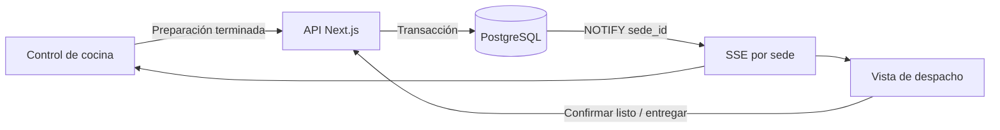

# T11.4 — Vista de pedidos para despacho y control de cocina

## 1. Objetivo

Permitir que cocina comunique el fin de una preparación y que despacho confirme el pedido listo y su entrega mediante el código único, con datos persistentes y actualización automática por sede.

## 2. Alcance

La aplicación Next.js de la raíz opera con `/despacho/smp`, `/despacho/lm`, `/control-cocina/smp` y `/control-cocina/lm`. Estas dos últimas son la única interfaz de cocina por sede; sustituyen y retiran el monitor histórico `/cocina/*`. El frontend Vite HU-01 permanece separado. No se integra aquí el pago o alta real de pedidos HU-10.

## 3. Arquitectura

Next.js consulta PostgreSQL mediante un pool de lectura y conexiones operativas separadas en `lib/db.ts`. Cada ruta resuelve `SMP` o `LM` en el servidor y pasa `sede_id` como parámetro SQL. Las escrituras llaman una sola función PostgreSQL por acción; cada llamada es una sentencia atómica y bloquea el pedido con `FOR UPDATE`. La función de control T11.3 valida las transiciones, los triggers T11.2 escriben historial y T11.3 emite invalidaciones reutilizadas por el control actual. T11.4 agrega un trigger que exige aviso confirmado antes de `2 → 3`, conserva el aviso y envía invalidaciones de despacho. SSE transmite fotos completas, nunca credenciales SQL.

## 4. Componentes implementados

| Componente | Función |
|---|---|
| `components/OperationsBoard.tsx`, `app/operations.css` | Lista táctil, avisos pendientes, detalle, productos, controles y errores. En desarrollo puede solicitar un pedido de prueba si el servidor lo habilita. Estilos encapsulados en `.operations`. |
| `app/despacho/*`, `app/control-cocina/*` | Cuatro rutas operativas por sede. |
| `lib/dispatch.ts` | Consultas filtradas y llamadas a funciones SQL; el control adicional excluye avisos ya persistidos. Rechaza credenciales con DML directo sobre pedidos, avisos o historial. |
| `lib/db.ts` | Mantiene lectura T11.3 y añade pools separados de cocina, despacho y generación de pruebas; todos fallan cerrados sin su credencial limitada. |
| `lib/operations-security.ts` | Control de origen, clave interna por sede y área, CSRF firmado y verificación de cookie. |
| `app/api/operations/[site]/stream` | SSE de fotos completas filtradas por sede. |
| `app/api/operations/[site]/token` | Token CSRF de una hora, cookie HttpOnly y SameSite Strict. |
| `app/api/operations/[site]/orders/[id]` | Escrituras validadas; nunca confía en el estado o sede enviados en JSON. |
| `app/api/operations/[site]/test-orders` | Genera pedidos sintéticos solo en desarrollo, con CSRF, área de despacho, conexión SQL exclusiva y marcador persistente de entorno. |
| `lib/operations-stream.ts` | Comparte la escucha SSE para control y despacho en los canales permitidos. |
| `lib/operations-site.ts` | Resuelve de forma parametrizada la sede de las rutas operativas. |

## 5. Flujo entre cocina y despacho

1. El pedido pagado aparece en `PREPARANDO`; los `RECIBIDO` históricos siguen en la lista de despacho.
2. El control de cocina muestra ID, productos y cantidades de pedidos `PREPARANDO` de su sede que aún no tienen aviso. Al pulsar «Preparación terminada», se inserta un aviso único. El pedido sigue en `PREPARANDO`, pero la siguiente foto SSE lo retira del control, incluso tras una reconexión.
3. Despacho ve el aviso en «Preparaciones terminadas», abre el pedido y confirma `LISTO_RECOJO`. En una transacción se marca la confirmación del aviso y se cambia el estado.
4. El trigger histórico registra origen `DESPACHO`; los canales operativos actualizan las fotos SSE. El aviso deja de ser pendiente.
5. Despacho compara en el servidor el código ingresado con el del pedido seleccionado. Si coincide y sigue listo, registra `ENTREGADO`; la foto siguiente lo retira de la lista activa.

## 6. Estados y transiciones

| Estado actual | Área | Acción | Resultado |
|---|---|---|---|
| `RECIBIDO` | Despacho | Lectura histórica | Permanece visible; sin confirmación directa. |
| `PREPARANDO` | Cocina | Preparación terminada | Aviso persistente; estado sin cambio. |
| `PREPARANDO` con aviso pendiente | Despacho | Confirmar listo | `LISTO_RECOJO`, origen `DESPACHO`. |
| `LISTO_RECOJO` | Despacho | Código correcto | `ENTREGADO`, origen `DESPACHO`. |
| `ENTREGADO` | — | — | Excluido de lista activa; historial conservado. |

## 7. Cambios de base de datos

[`T11.4_migracion_avisos_preparacion.sql`](../Codigo/T11.4_migracion_avisos_preparacion.sql) crea `public.avisos_preparacion(aviso_id, pedido_id, terminado_en, confirmado_en)`. `pedido_id` es FK y `UNIQUE`; `confirmado_en IS NULL` define pendientes. La sede se obtiene del pedido. Un trigger valida que el aviso nazca pendiente durante `PREPARANDO`; otro exige un aviso confirmado antes de `PREPARANDO → LISTO_RECOJO`, incluso ante un `UPDATE` directo. Ninguno reemplaza los triggers T11.2/T11.3. Tres funciones `SECURITY DEFINER` fijan `search_path` en `pg_catalog, public, pg_temp` y usan referencias explícitas; `public` es necesario porque el trigger de historial T11.2 usa una tabla sin calificar, mientras que `pg_temp` queda al final para impedir que una tabla temporal la sustituya. La migración rechaza `CREATE` concedido a `PUBLIC` en ese esquema. Las funciones bloquean el pedido antes de actuar y las dos transiciones exigen actualizar exactamente una fila. El trigger histórico registra las transiciones con origen `DESPACHO`. Los avisos y el historial no se eliminan.

La migración usa `public` explícito, comprueba tablas, catálogo, triggers y `DEFAULT 2` de T11.3 antes del DDL, y limita espera por bloqueos a 5 segundos y duración de sentencias a 60 segundos. Es aditiva y transaccional, pero la FK y los nuevos triggers toman bloqueos temporales sobre `pedidos`. Para instalarla por primera vez en otro entorno se debe revisar su estado real y una copia o plan de respaldo. No es reejecutable automáticamente si ya existe la tabla: se detiene para revisión.

[`T11.4_privilegios_operativos.sql`](../Codigo/T11.4_privilegios_operativos.sql) fue la segunda fase aplicada. Crea grupos `NOLOGIN` de lectura, cocina y despacho. Solo lectura recibe `SELECT` de las tablas necesarias; cocina recibe `EXECUTE` para terminar y despacho para confirmar/entregar. Verifica que ninguno heredó DML directo sobre pedidos, avisos o historial ni funciones de otra área. Se crearon tres usuarios `LOGIN` distintos, cada uno miembro de un solo grupo, y se configuraron `DATABASE_URL`, `KITCHEN_DATABASE_URL` y `DISPATCH_DATABASE_URL` sin registrar contraseñas en el repositorio. El backend rechaza credenciales operativas iguales a la de lectura y vuelve a comprobar privilegios DML en cada operación. La cuenta propietaria de Neon no se usa como cuenta operativa.

[`T11.4_reversion_avisos_preparacion.sql`](../Codigo/T11.4_reversion_avisos_preparacion.sql) retira únicamente funciones y triggers T11.4; conserva la tabla, sus avisos, índice, pedidos e historial. Hay que detener primero las rutas de escritura T11.4 y autorizar la reversión. Al retirarse `trg_t114_exigir_aviso_listo`, vuelve a regir la regla T11.3 anterior: `2 → 3` con origen `DESPACHO` sin exigir aviso. Los grupos `NOLOGIN` permanecen para revisión separada. Una nueva activación con avisos conservados necesitaría una migración específica; no se vuelve a ejecutar ciegamente el archivo inicial.

**Aplicación en Neon `allinstant-dev/development/neondb`, 18 de octubre de 2026.** Se confirmó PostgreSQL 18.6, T11.2/T11.3 presentes, T11.4 ausente y ausencia de `CREATE` para `PUBLIC` en el esquema `public`. La migración estructural se aplicó en una transacción; la verificación posterior encontró cuatro triggers y siete funciones T11.4, sin `EXECUTE` público. El pedido y su fila de historial preexistentes permanecieron sin cambios y la tabla nueva quedó con cero avisos. Después se aplicó [`T11.4_privilegios_operativos.sql`](../Codigo/T11.4_privilegios_operativos.sql) y se crearon tres usuarios limitados para lectura, cocina y despacho, cada uno miembro de un solo grupo. Se verificaron sus permisos efectivos: sin DML directo sobre pedidos, avisos o historial; `EXECUTE` permitido solo para las funciones de su área; llamadas de otra área denegadas. Las funciones permitidas devolvieron `not-found` para un pedido inexistente.

Al aplicar la migración no se pudo crear una instantánea ni una rama hija de respaldo porque `development` tenía vencimiento el 23 de octubre de 2026. El proyecto ofrecía seis horas de historial de recuperación; antes de migrar se registró LSN `0/1DBE8B0` a las `2026-10-18T18:28:35Z`. Esto no equivale a un respaldo independiente. En la comprobación posterior del 18 de octubre de 2026, la rama `development` ya no tenía fecha de expiración configurada. La migración fue aditiva y no reescribió filas existentes. La prueba transaccional [`T11.4_pruebas_post_migracion.sql`](../Testing/T11.4_pruebas_post_migracion.sql) pasó todas sus aserciones dentro de un `SAVEPOINT` y se revirtió; no dejó pedidos ni avisos ficticios, aunque las secuencias `IDENTITY` pueden conservar saltos.

Una prueba adicional con conexiones PostgreSQL independientes creó un pedido sintético SMP y comprobó llamadas simultáneas: terminar produjo `ok/duplicate`, confirmar listo `ok/invalid-state` y entregar `ok/invalid-state`; un código erróneo devolvió `invalid-code`. El estado final fue `ENTREGADO`, con un aviso confirmado y tres filas de historial. Una conexión directa con `LISTEN` recibió dos avisos en `allinstant_cocina` y cuatro en `allinstant_despacho` después de los `COMMIT`. La prueba limpió el pedido y sus filas asociadas; la verificación posterior mostró nuevamente un pedido, una fila de historial y cero avisos, sin datos sintéticos persistentes.

La aplicación usa credenciales limitadas en `.env.local`, ignorado por Git. Se comprobaron las cuatro conexiones reales: lectura, escucha directa, cocina y despacho. La API de Neon creó inicialmente tres cuentas `*_login` con `neon_superuser` por defecto; no se usaron. Tras autorización específica del usuario se eliminaron las tres y se verificó que solo permanecen los grupos `NOLOGIN` y las cuentas limitadas `*_app`.

## 8. Actualización en tiempo real

Las vistas operativas escuchan `allinstant_cocina` y `allinstant_despacho` mediante conexión PostgreSQL directa, filtrando el payload por `sede_id`. Se envía una foto inicial tras `LISTEN` y una foto nueva al recibir invalidaciones. `EventSource` reconecta; la nueva foto recupera el estado actual y los avisos persistidos que se perdieron durante el corte. El canal cocina cubre altas de pedidos, cambios de detalle y renombres de productos; el nuevo canal cubre avisos y estados de despacho. No hay sondeo periódico. La sesión Node, la conexión directa de Neon y un proxy sin buffering SSE son necesarios.

## 9. Reglas de validación y seguridad

- Cada consulta y escritura usa `sede_id` resuelto en el servidor y parámetros SQL. Las funciones `SECURITY DEFINER` vuelven a filtrar por sede y bloquean el pedido; no reciben SQL dinámico.
- Solo un pedido `PREPARANDO` admite aviso. La función de despacho confirma el aviso y cambia a `LISTO_RECOJO` en la misma sentencia; el trigger de PostgreSQL rechaza la transición sin aviso confirmado. Un pedido `LISTO_RECOJO` admite una sola entrega con código exacto validado en PostgreSQL.
- Las escrituras exigen `Origin` coincidente, `Sec-Fetch-Site` local cuando lo envía el navegador, JSON, encabezado personalizado y token CSRF firmado ligado a cookie HttpOnly, sede y área. La cookie es `SameSite=Strict`.
- En producción, la API exige `OPERATIONS_ORIGIN`, `OPERATIONS_CSRF_SECRET` y claves distintas para `SMP_CONTROL`, `SMP_DISPATCH`, `LM_CONTROL` y `LM_DISPATCH`. La acción determina el área requerida en el servidor: `finish` exige `CONTROL`; `ready` y `deliver` exigen `DISPATCH`. Un proxy de confianza debe **eliminar** cualquier `X-Alesar-Internal-Key` entrante e inyectar únicamente la clave correspondiente a la red interna o VPN de la sede y área del terminal. Debe preservar Host/protocolo externos para la validación de origen. La aplicación Node debe ser inaccesible directamente desde redes externas; usar HTTPS, firewall y proxy sin buffering SSE. Una clave en el navegador no sirve como control de acceso.
- Sin login ni asociación de dispositivos, cualquier persona que alcance la red interna autorizada de una sede y área podría operar esos pedidos. La segmentación de red y los controles físicos del terminal son esenciales. La configuración local escucha solo `127.0.0.1`; el acceso externo falla cerrado si faltan secretos o proxy.
- Los errores de servidor registran solo códigos técnicos, nunca nombre, teléfono ni código de recojo. Las cuatro URL de base de datos y escucha permanecen en el servidor. El rol de lectura debe conservar `SELECT` y `LISTEN` para las fotos SSE operativas.
- Los grupos de PostgreSQL son por área, no por sede. Si se filtra una credencial SQL operativa, podría invocar su función para otra sede pasando un `sede_id` válido. La separación de sedes en la aplicación depende del proxy por red y de la resolución de sede en el servidor; un esquema futuro puede añadir roles SQL por sede si se requiere aislamiento aun frente al robo de credenciales.

## 10. Escenarios BDD

| ID | Dado | Cuando | Entonces |
|---|---|---|---|
| E01 | Pedidos SMP y LM | Abro despacho SMP | Solo muestra SMP, de más antiguo a más reciente. |
| E02 | Pedido `PREPARANDO` | Cocina termina | Aviso único persistido; estado e historial sin transición. |
| E03 | Aviso pendiente | Recargo despacho | Sigue en «Preparaciones terminadas». |
| E04 | Aviso pendiente | Despacho confirma listo | Estado `LISTO_RECOJO`, origen `DESPACHO`; aviso sale de pendientes y cocina retira productos. |
| E05 | Pedido sin aviso | Despacho intenta confirmar | Rechazo sin cambio de estado. |
| E06 | Pedido listo | Introduzco código erróneo | Error; permanece listo. |
| E07 | Pedido listo | Introduzco código exacto | Pasa a `ENTREGADO` y desaparece de lista activa. |
| E08 | Pedido entregado | Repito entrega | Rechazo; no duplica historial. |
| E09 | SSE se corta | Reconecta | Recibe foto vigente, incluidos avisos persistidos. |
| E10 | Cambio en otra sede | Estoy en SMP | No se carga como pedido SMP. |

## 11. Matriz de trazabilidad

| Requisito | Implementación | Verificación local |
|---|---|---|
| Sede, orden, datos y estados | `listDispatchOrders`, `OperationsBoard` | `dispatch.test.ts` consulta y presentación de datos. |
| Control de cocina y aviso único | `listControlOrders`, `fn_t114_terminar_preparacion`, FK/UNIQUE | Prueba SQL y dos conexiones simultáneas en Neon. |
| Listo e historial | `fn_t114_confirmar_listo`, trigger de aviso, control T11.3 e historial T11.2 | Prueba SQL y dos confirmaciones simultáneas; historial correcto tras `COMMIT`. |
| Código y entrega única | `fn_t114_entregar_pedido` con bloqueo y comparación exacta | Código erróneo y dos entregas simultáneas verificados en Neon. |
| Privilegios mínimos y reversión | Grupos `NOLOGIN`, pools separados, script de reversión | Permisos de usuarios `LOGIN` limitados verificados en Neon; reversión no ejecutada. |
| Actualización/reconexión | `createKitchenStream`, `EventSource`, triggers | `dispatch-stream.test.ts`; `LISTEN/NOTIFY` real y primera respuesta SSE local verificados; reconexión de navegador pendiente. |
| CSRF, origen y red | `operations-security.ts`, proxy interno | `operations-security.test.ts`; configuración proxy pendiente. |

## 12. Pruebas

Se ejecutaron pruebas focalizadas T11.3/T11.4, el contrato SQL y `npm run typecheck`; no se ejecutaron la suite completa ni el build. `.env.local`, ignorado por Git, contiene las conexiones de lectura, escucha directa y usuarios limitados de cocina y despacho; nunca publicar su contenido. Antes de la unificación, las rutas históricas T11.3 devolvían HTTP 200 con Neon `development`; actualmente solo son vigentes las cuatro rutas T11.4 y `/cocina/*` devuelve 404. Los flujos SSE de despacho SMP y control de cocina LM devolvieron HTTP 200, tipo `text/event-stream` y un primer evento. La prueba SQL transaccional, el ensayo de dos sesiones y `NOTIFY` tras `COMMIT` pasaron en Neon. La reconexión de navegador y las restricciones del proxy siguen pendientes de un despliegue interno. No se crearon capturas ni videos ficticios. La validación complementaria de identidad, sede y nuevas fotos está documentada en [T11.5](T11.5-validacion-identificacion-estados-sede-pedidos.md).

## 13. Limitaciones

Las dos fases T11.4 y las cuentas limitadas están instaladas en `development`. Se validaron las transiciones, la concurrencia, los avisos tras `COMMIT`, las rutas y la primera respuesta SSE. Quedan por validar la interacción táctil y reconexión en navegador, la reversión y la configuración del proxy interno antes del despliegue operativo. HU-10 aún debe escribir pedidos pagados en una transacción. La vista muestra el código único para el personal de despacho, por lo que exige proteger físicamente esa pantalla. Los avisos se crean una sola vez por pedido, acorde con el flujo irreversible de estados actual. La disponibilidad SSE requiere un proceso Node persistente y conexión PostgreSQL directa.

## 14. Conclusiones

T11.4 está implementada y validada en `development` para revisión antes del push. El despliegue operativo requiere configurar y comprobar el proxy interno, además de revisar la interacción táctil y la reconexión en un navegador autorizado.

## 15. Corrección del control adicional de cocina

La consulta del control incluye solo pedidos `PREPARANDO` y pagados de su sede para los que no existe una fila en `avisos_preparacion`. La condición se evalúa en la consulta completa que alimenta SSE, no solo al pulsar el botón. Por ello, después de crear el aviso persistente, el pedido desaparece de `/control-cocina/smp` o `/control-cocina/lm`, sigue en `PREPARANDO` y queda disponible para que despacho confirme `LISTO_RECOJO`. Una reconexión vuelve a ejecutar la misma consulta y no lo reincorpora.

## 16. Generador de pedidos sintéticos

El botón «+ Generar pedido de prueba» se ofrece únicamente en `/despacho/smp` y `/despacho/lm` cuando el proceso se ejecuta con `NODE_ENV=development` y `ENABLE_TEST_ORDERS=true`. El endpoint vuelve a exigir ambas condiciones, acceso de despacho y CSRF; la ocultación del botón no constituye el control de seguridad.

El endpoint abre solo `TEST_ORDERS_DATABASE_URL`, que debe ser distinta de las conexiones de lectura, cocina y despacho. En la configuración local verificada, usa `allinstant_t114_test_app`; no se publican su URL ni contraseña. Antes de invocar la función, consulta `t114_entorno_pruebas`; la fila única `development` es una segunda barrera persistente. Los scripts no se aplican en producción y la función también rechaza la llamada si falta ese marcador.

[`T11.4_migracion_pedidos_prueba.sql`](../Codigo/T11.4_migracion_pedidos_prueba.sql) crea el marcador y `t114_pedidos_prueba`. Esta última tabla identifica inequívocamente cada pedido sintético por FK, sin depender de nombre, DNI, teléfono ni código. `fn_t114_generar_pedido_prueba` inserta de forma atómica cabecera pagada en `PREPARANDO`, un detalle, el historial originado por los triggers existentes y el marcador. Elige un producto existente y usa su último precio registrado en desarrollo; usa `1.00` solo si ese producto aún no tiene detalle histórico. Los códigos se generan de forma aleatoria y la restricción única de `pedidos` resuelve carreras.

[`T11.4_privilegios_pedidos_prueba.sql`](../Codigo/T11.4_privilegios_pedidos_prueba.sql) concede al grupo `allinstant_t114_test_orders` solo `SELECT` sobre el marcador y `EXECUTE` de la función. La cuenta limitada local no recibe DML directo. La limpieza no tiene botón público: [`T11.4_previsualizacion_limpieza_pedidos_prueba.sql`](../Testing/T11.4_previsualizacion_limpieza_pedidos_prueba.sql) solo enumera el alcance y cualquier eliminación exige autorización explícita.

## 17. Prueba manual pendiente

Con las dos variables anteriores y la conexión limitada configuradas únicamente en `.env.local`, abrir la sede correspondiente, generar un pedido y ejecutar el flujo manual: control de cocina, «Preparación terminada», despacho, confirmación de listo y entrega con el código mostrado. Debe repetirse en SMP y LM y debe comprobarse que una reconexión SSE no devuelva el pedido al control adicional. Esta verificación visual no se ejecutó durante esta tarea.

## 18. Escenarios BDD añadidos

| ID | Dado | Cuando | Entonces |
|---|---|---|---|
| E11 | Un pedido `PREPARANDO` sin aviso | Cocina registra la finalización | Se crea un aviso y el pedido sale del control adicional, sin cambiar de estado. |
| E12 | El aviso de E11 persistido | El control se reconecta | El pedido no reaparece en el control y conserva `PREPARANDO` hasta despacho. |
| E13 | Despacho habilitado en desarrollo | Genera en SMP o LM | El pedido sintético pertenece a la sede de la ruta, queda pagado y en `PREPARANDO`. |
| E14 | El generador se usa varias veces | Se crean pedidos | Cada pedido tiene identificador y código únicos, detalle e historial inicial. |
| E15 | Producción, bandera ausente o marcador no válido | Se invoca el endpoint | La solicitud se rechaza antes de crear un pedido. |
| E16 | Una sede recibe eventos de la otra | Se actualiza SSE | La foto de la sede abierta no mezcla pedidos de la otra. |

## 19. Verificaciones adicionales

Las pruebas focalizadas `operations-stream.test.ts`, `operations-route.test.ts`, `dispatch.test.ts`, `test-orders-route.test.ts` y `operations-board.test.tsx` pasaron 24 casos el 18-10-2026. Cubren SSE por sede, rutas vigentes, retiro tras aviso, flujo de control y despacho, bloqueos de entorno y autorización del endpoint, marcador de base y visibilidad del botón. La comprobación HTTP local confirmó `/control-cocina/smp` y `/control-cocina/lm` con 200, y `/cocina/smp`, `/cocina/lm` y el endpoint SSE histórico con 404. Tras ajustar la función SQL para tomar el precio existente, se la aplicó exclusivamente en `allinstant-dev/development` y se llamó dentro de un `SAVEPOINT`; el `ROLLBACK` no dejó pedidos sintéticos marcados. La verificación posterior confirmó el marcador `development`, `EXECUTE` no público y la ausencia de DML para la cuenta limitada.

Después de retirar la cuenta amplia creada automáticamente por Neon, se verificó que `allinstant_t114_test_orders_app` ya no existe. `allinstant_t114_test_app` permanece como cuenta exclusiva: no es superusuario, no crea bases ni roles, no replica, pertenece solo a `allinstant_t114_test_orders`, puede leer el marcador y ejecutar la función, y no tiene `INSERT`, `UPDATE` ni `DELETE` directo sobre `pedidos`.

Se inició el servidor local con `.env.local`, sin mostrar credenciales, y se invocó el mismo endpoint que usa el botón. Generó un pedido SMP y uno LM, ambos marcados; cada uno pasó por aviso de cocina, confirmación de despacho y entrega con código correcto mediante HTTP local. La consulta final confirmó estado `ENTREGADO`, pago confirmado, un detalle, tres eventos de historial y aviso confirmado para cada pedido, con una sola fila marcada por sede. Durante esta prueba se detectó y corrigió que el secreto CSRF de desarrollo podía diferir entre módulos de ruta; ahora se conserva en el proceso Node, mientras producción sigue exigiendo `OPERATIONS_CSRF_SECRET`. Tras la corrección, las suites focalizadas `operations-security.test.ts` y `test-orders-route.test.ts` pasaron 8 casos.

No se ejecutaron compilación, typecheck global, suite completa, instalación de paquetes ni pruebas visuales por rutina. No se produjeron capturas o videos como evidencia de este cambio.

## 20. Límites y revisión de seguridad

La cuenta limitada `allinstant_t114_test_app` es la única configurada para el generador y fue verificada sin superusuario ni DML directo. La cuenta amplia `allinstant_t114_test_orders_app` ya fue eliminada de `development`. Los dos pedidos sintéticos de la prueba de integración permanecen marcados y entregados para trazabilidad; cualquier limpieza debe partir de la previsualización y contar con autorización explícita. La validación visual de navegador y reconexión SSE sigue pendiente.

### Recuperación SSE reportada para cocina LM (21-10-2026)

El usuario informó una prueba manual en `/control-cocina/lm`: con la conexión
inicial activa, detuvo Next.js, observó `Reconectando…` y fallos del stream;
al reiniciar Next recibió un nuevo `200`, el indicador `En vivo` y luego vio el
pedido sintético 33. Es evidencia reportada por el usuario de recuperación tras
reinicio del servidor. No acredita despacho, corte físico de red ni confirma
que el pedido apareciera sin actualización manual.
