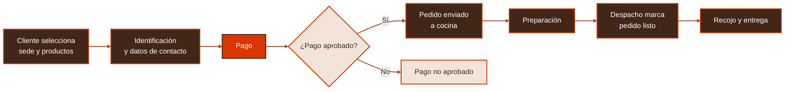

<p align="center">
  
</p>

<p align="center">
  <strong>Pedidos anticipados para recojo en las cafeterías Alesar</strong>
</p>

<p align="center">
  <a href="https://www.cateringalesar.com/"><strong>ALESAR · Sitio oficial</strong></a>
</p>

<!-- LOGOTIPO OFICIAL: cuando se cuente con el archivo autorizado, guardarlo en
     assets/logo-alesar.png y reemplazar el enlace de texto anterior por:
     <p align="center"><a href="https://www.cateringalesar.com/"></a></p>
-->

<p align="center">
  
  
  
</p>

<p align="center"><sub>Proyecto académico · Ingeniería de Software · Universidad Peruana Cayetano Heredia (UPCH)</sub></p>

---

## Navegación

<p align="center">
  <a href="#sobre-alinstant">Sobre AlInstant</a> ·
  <a href="#el-problema">Problema</a> ·
  <a href="#la-solución">Solución</a> ·
  <a href="#funcionalidades-propuestas">Funcionalidades</a> ·
  <a href="#tecnologías-y-herramientas">Tecnologías</a> ·
  <a href="#avances-y-recursos">Recursos</a>
</p>

<p align="center"></p>

## Sobre AlInstant

**AlInstant** es una propuesta de sistema web para gestionar **pedidos anticipados para recojo presencial** en las cafeterías **Alesar** de las sedes **San Martín de Porres (SMP)** y **La Molina**. Se desarrolla como parte del curso de Ingeniería de Software de la **Universidad Peruana Cayetano Heredia**.

Su objetivo es simplificar la experiencia de compra, reducir la necesidad de hacer cola para registrar pedidos y ayudar al personal a organizar la preparación y entrega de productos.

> **Alcance:** pedidos para recoger en el local; no contempla delivery.

## El problema

El proceso presencial tradicional obliga a los clientes a esperar para solicitar y pagar sus pedidos. Además, el uso de tickets físicos y la coordinación manual entre atención, cocina y despacho pueden dificultar el seguimiento oportuno de cada orden, especialmente en horas de alta demanda.

## La solución

AlInstant plantea digitalizar el recorrido del pedido, desde la selección de productos y el pago hasta su preparación y entrega en la sede elegida. De esta manera, el cliente puede planificar su compra y el personal cuenta con información del pedido y de su estado.

<div align="center">



<sub>Flujo funcional propuesto; no representa una aplicación completamente implementada.</sub>

</div>

<p align="center"></p>

## Funcionalidades propuestas

| Cliente | Operación de Alesar |
|:--|:--|
| Selección de sede y productos disponibles | Control de disponibilidad de productos por sede |
| Identificación mediante DNI y registro de WhatsApp | Visualización de pedidos por sede |
| Pago digital con Yape o tarjeta | Recepción de pedidos en cocina |
| Consulta del estado y código de recojo | Actualización de estados por despacho y registro de entrega |

> Estas son funcionalidades definidas en el alcance y documentación del proyecto. Su presencia aquí **no significa que todas estén implementadas**.

## Tecnologías y herramientas

Solo se incluyen herramientas y tecnologías respaldadas por archivos o enlaces del proyecto:

| Tecnología / herramienta | Uso documentado |
|:--|:--|
| **PostgreSQL (SQL)** | Diseño de la estructura de pedidos, detalles y estados, y scripts de pruebas |
| **Neon** | Entorno de pruebas de PostgreSQL documentado mediante evidencia de ejecución |
| **Vite, React y TypeScript** | Prototipo de la web de clientes HU-01 en `Sprint 1/Codigo/frontend/` |
| **Next.js, React y TypeScript** | Pantalla local de cocina de la tarea T11.3 |
| **StarUML (UML)** | Diagramas de actividades y modelos editables (`.mdj`) |
| **Figma** | Diseño y prototipado; [abrir prototipo](https://www.figma.com/design/w1Kpyyg6ZOSXDVEe60AUfq/Untitled?node-id=0-1&p=f) |
| **GitHub** | Control de versiones y organización de entregables por sprint |

## Dos aplicaciones web

| Aplicación | Ubicación | Estado actual |
|:--|:--|:--|
| Web de clientes HU-01 | [`Sprint 1/Codigo/frontend/`](https://github.com/Marco404-Dev/Alesar/tree/main/Sprint%201/Codigo/frontend) | Prototipo independiente con Vite: selección de sede, catálogo de ejemplo, carrito, resumen y navegación al pago simulado. No registra pedidos ni procesa pagos reales. |
| Monitor operativo de cocina T11.3 | Raíz del repositorio: `app/`, `components/` y `lib/` | Aplicación independiente con Next.js: consulta de productos pendientes por sede desde PostgreSQL en Neon y actualización mediante SSE. |

Son dos proyectos con archivos `package.json` y `package-lock.json` separados. Cada uno requiere instalar sus dependencias en su propio directorio. La interfaz HU-01 todavía no utiliza la base Neon ni está conectada con el monitor; la integración del pago y la creación de pedidos corresponden a trabajo posterior. La pantalla de despacho también está pendiente.

### Ejecutar la web de clientes HU-01

Usa Node.js **20.19 o posterior** dentro de la versión 20, o **22.12 o posterior**. Desde la raíz del repositorio:

```powershell
cd "Sprint 1/Codigo/frontend"
npm install
npm run dev
```

Abre la dirección local que muestre Vite en la terminal. Este prototipo utiliza datos de ejemplo y no necesita `DATABASE_URL` ni otras credenciales de Neon.

## T11.3 — Monitor de productos de cocina

La aplicación Next.js de la raíz de este repositorio ofrece dos rutas locales: `/cocina/smp` y `/cocina/lm`. Cada monitor muestra una lista vertical de líneas de producto de pedidos `RECIBIDO` o `PREPARANDO` de su sede. Cada línea contiene solo ID de producto, nombre y cantidad. Las líneas conservan internamente su pedido y se ordenan por la confirmación del pedido, sin fusionar productos iguales de pedidos diferentes. El monitor no modifica estados ni ofrece controles de operación.

El esquema T11.2 original exigía `RECIBIDO` al insertar. La [migración T11.3](./Sprint%201/Codigo/T11.3_migracion_pedidos_cocina.sql), aplicada y verificada en Neon `development` según los resultados del proyecto, establece `PREPARANDO` como estado inicial y añade avisos PostgreSQL. Los pedidos históricos en `RECIBIDO` siguen visibles. La [documentación técnica de T11.3](./Sprint%201/Documentacion/T11.3-implementacion-monitor-cocina.md) describe la implementación, pruebas reportadas y evidencias disponibles.

### Ejecutar el monitor de cocina T11.3

1. Usa la misma versión de Node.js indicada arriba y ejecuta `npm install` **en la raíz**, no en el directorio de Vite.
2. Copia [`.env.example`](.env.example) a `.env.local` en la raíz. Este último archivo permanece fuera de Git.
3. En `DATABASE_URL`, coloca la cadena de conexión de Neon para la base que ya contiene el esquema T11.2. Conserva `sslmode=require`. **No ejecutes de nuevo el script de creación sobre esa base.**
4. Se recomienda definir `DATABASE_LISTEN_URL` con una conexión **directa** a esa misma base, sin `-pooler` en el host. Si falta y `DATABASE_URL` es una URL pooler de Neon, el servidor deriva el host directo del mismo endpoint para `LISTEN`. Una URL explícita de otra base o endpoint se rechaza.
5. Ejecuta `npm run dev` desde la raíz y abre [http://127.0.0.1:3000/cocina/smp](http://127.0.0.1:3000/cocina/smp) o [http://127.0.0.1:3000/cocina/lm](http://127.0.0.1:3000/cocina/lm).

El servidor local escucha solo en `127.0.0.1`. No hay autenticación individual ni endpoints de escritura de pedidos. **Las rutas `/cocina/smp` y `/cocina/lm` identifican la sede, pero no autorizan al dispositivo o a la persona.** Tampoco debe exponerse públicamente `/api/kitchen/[site]/stream`: antes de cualquier despliegue en red, restringe la web operativa a la red interna de ALESAR o una VPN mediante firewall/proxy y usa HTTPS. Sin esos controles, quien alcance la URL podrá consultar las listas. Las credenciales de Neon deben permanecer únicamente en variables de entorno del servidor; no incluyas `.env.local`, cadenas de conexión reales ni otros secretos en Git.

### Eventos en tiempo real

El navegador usa Server-Sent Events (SSE). El servidor abre una conexión PostgreSQL directa con `LISTEN allinstant_cocina`, envía una consulta completa al conectar y vuelve a consultar cuando recibe un `NOTIFY` de su sede. `EventSource` reconecta automáticamente y recibe otra consulta completa, de modo que recupera cambios perdidos durante el corte. Los mensajes de mantenimiento de conexión no consultan la base de datos.

La migración T11.3 añade triggers sobre `pedidos`, `detalle_pedido` y cambios relevantes en `productos.nombre`; los avisos se entregan después de confirmar la transacción. El servidor debe ejecutarse como proceso Node persistente capaz de mantener la conexión SSE y `LISTEN`.

La comunicación desde el dispositivo adicional de cocina hacia despacho queda pendiente. Ese dispositivo no deberá cambiar el pedido directamente a `LISTO_RECOJO`; despacho lo confirmará en una tarea posterior. La web de clientes HU-01 existe como prototipo separado; su integración y la pantalla de despacho están fuera del alcance de T11.3.

### Verificación

```bash
npm test
npm run typecheck
npm run build
```

Las pruebas automatizadas usan dobles de base de datos y no modifican Neon. Para verificar pedidos reales, la base debe tener datos confirmados y ambas URL deben apuntar a la misma instancia. El flujo de cocina solo devuelve líneas de producto y sus IDs internos de línea/pedido para mantener la relación; no entrega código de recojo, hora, estado ni datos del cliente.

## Avances y recursos

El repositorio contiene documentación funcional, diagramas, scripts SQL y pruebas. También dispone de carpetas para las entregas de tres sprints.

| Recurso | Enlace |
|:--|:--|
| **Sprint 1** | [Documentación, modelado y pruebas](./Sprint%201) |
| **Sprint 2** | [Scripts de base de datos y entregables](./Sprint%202) |
| **Sprint 3** | [Estructura de entregables](./Sprint%203) |
| **Modelo de pedidos y estados** | [Script SQL](./Sprint%202/Codigo/Base%20de%20Datos/T11.2_estructura_pedidos_y_estados.sql) |
| **Web de clientes HU-01** | [Frontend Vite en `main`](https://github.com/Marco404-Dev/Alesar/tree/main/Sprint%201/Codigo/frontend) |
| **Modelo HU-02 de disponibilidad** | [Documentación en `main`](https://github.com/Marco404-Dev/Alesar/blob/main/Sprint%201/Documentacion/T02.2-modelo-datos-disponibilidad.md) |
| **Testing Sprint 1** | [Pruebas automatizadas y SQL](./Sprint%201/Testing/README.md) |
| **Pruebas SQL T11.2** | [Script original](./Sprint%201/Testing/T11.2_pruebas_pedidos_y_estados.sql) |
| **Evidencias Sprint 1** | [Capturas, videos e informes](./Sprint%201/Pruebas/README.md) |
| **T11.1 actualizada** | [Reglas de visualización](./Sprint%201/Documentacion/T11.1-reglas-visualizacion-pedidos.md) |
| **T11.2 actualizada** | [Especificación PostgreSQL](./Sprint%201/Documentacion/T11.2-estructura-pedidos-estados.md) |
| **T11.3 monitor de cocina** | [Documentación técnica y trazabilidad](./Sprint%201/Documentacion/T11.3-implementacion-monitor-cocina.md) |
| **T11.3 base de datos** | [Migración, pruebas y reversión](./Sprint%201/Codigo/README_T11.3_BD.md) |
| **Prototipo en Figma** | [Ver diseño](https://www.figma.com/design/w1Kpyyg6ZOSXDVEe60AUfq/Untitled?node-id=0-1&p=f) |

<p align="center"></p>

<p align="center">
  <strong>AlInstant · Experiencia de compra más ágil, preparación mejor organizada.</strong>
</p>
<p align="center"><sub>Proyecto académico en desarrollo · UPCH</sub></p>
