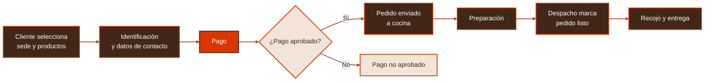

  

  <strong>Pedidos anticipados para recojo en las cafeterías Alesar</strong>

  <a href="https://www.cateringalesar.com/"><strong>ALESAR · Sitio oficial</strong></a>

<!-- LOGOTIPO OFICIAL: cuando se cuente con el archivo autorizado, guardarlo en
     assets/logo-alesar.png y reemplazar el enlace de texto anterior por:
     

-->

  
  
  

Proyecto académico · Ingeniería de Software · Universidad Peruana Cayetano Heredia (UPCH)

---

## Navegación

  <a href="#sobre-alinstant">Sobre AlInstant</a> ·
  <a href="#el-problema">Problema</a> ·
  <a href="#la-solución">Solución</a> ·
  <a href="#funcionalidades-propuestas">Funcionalidades</a> ·
  <a href="#tecnologías-y-herramientas">Tecnologías</a> ·
  <a href="#avances-y-recursos">Recursos</a>

## Sobre AlInstant

**AlInstant** es una propuesta de sistema web para gestionar **pedidos anticipados para recojo presencial** en las cafeterías **Alesar** de las sedes **San Martín de Porres (SMP)** y **La Molina**. Se desarrolla como parte del curso de Ingeniería de Software de la **Universidad Peruana Cayetano Heredia**.

Su objetivo es simplificar la experiencia de compra, reducir la necesidad de hacer cola para registrar pedidos y ayudar al personal a organizar la preparación y entrega de productos.

> **Alcance:** pedidos para recoger en el local; no contempla delivery.

## El problema

El proceso presencial tradicional obliga a los clientes a esperar para solicitar y pagar sus pedidos. Además, el uso de tickets físicos y la coordinación manual entre atención, cocina y despacho pueden dificultar el seguimiento oportuno de cada orden, especialmente en horas de alta demanda.

## La solución

AlInstant plantea digitalizar el recorrido del pedido, desde la selección de productos y el pago hasta su preparación y entrega en la sede elegida. De esta manera, el cliente puede planificar su compra y el personal cuenta con información del pedido y de su estado.

Flujo funcional propuesto; no representa una aplicación completamente implementada.

## Funcionalidades propuestas

| Cliente | Operación de Alesar |
|:--|:--|
| Selección de sede y productos disponibles | Control de disponibilidad de productos por sede |
| Identificación mediante DNI y registro de WhatsApp | Visualización de pedidos por sede |
| Pago digital con Yape o tarjeta | Recepción de pedidos en cocina |
| Consulta del estado y código de recojo | Actualización de estados por despacho y registro de entrega |

> Estas son funcionalidades definidas en el alcance y documentación del proyecto. Su presencia aquí **no significa que todas estén implementadas**.

## Tecnologías y herramientas

Solo se incluyen herramientas y tecnologías respaldadas por archivos o enlaces del proyecto:

| Tecnología / herramienta | Uso documentado |
|:--|:--|
| **PostgreSQL (SQL)** | Diseño de la estructura de pedidos, detalles y estados, y scripts de pruebas |
| **Neon** | Entorno de pruebas de PostgreSQL documentado mediante evidencia de ejecución |
| **StarUML (UML)** | Diagramas de actividades y modelos editables (`.mdj`) |
| **Figma** | Diseño y prototipado; [abrir prototipo](https://www.figma.com/design/w1Kpyyg6ZOSXDVEe60AUfq/Untitled?node-id=0-1&p=f) |
| **GitHub** | Control de versiones y organización de entregables por sprint |

No se atribuye todavía al proyecto un framework frontend, un backend ni una pasarela de pago integrada porque no se ha verificado su implementación en este repositorio.

## Avances y recursos

El repositorio contiene documentación funcional, diagramas, scripts SQL y pruebas. También dispone de carpetas para las entregas de tres sprints.

| Recurso | Enlace |
|:--|:--|
| **Sprint 1** | [Documentación, modelado y pruebas](./Sprint%201) |
| **Sprint 2** | [Scripts de base de datos y entregables](./Sprint%202) |
| **Sprint 3** | [Estructura de entregables](./Sprint%203) |
| **Modelo de pedidos y estados** | [Script SQL](./Sprint%202/Codigo/Base%20de%20Datos/T11.2_estructura_pedidos_y_estados.sql) |
| **Pruebas SQL** | [Script de pruebas](./Sprint%201/Pruebas/Codigo/T11.2_pruebas_pedidos_y_estados.sql) |
| **Prototipo en Figma** | [Ver diseño](https://www.figma.com/design/w1Kpyyg6ZOSXDVEe60AUfq/Untitled?node-id=0-1&p=f) |

  <strong>AlInstant · Experiencia de compra más ágil, preparación mejor organizada.</strong>

Proyecto académico en desarrollo · UPCH

